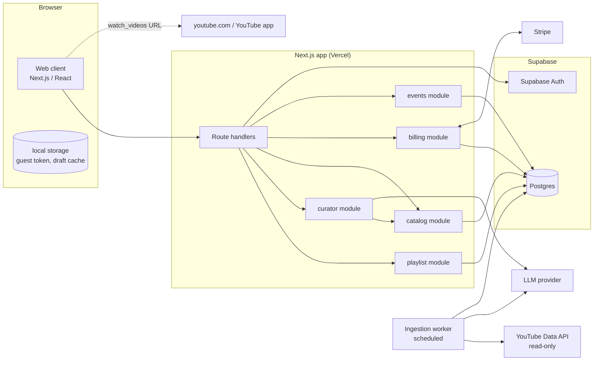
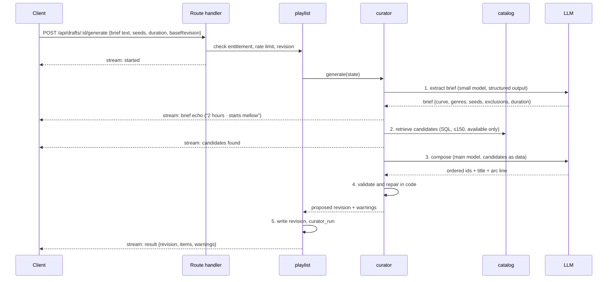

# Marquee TV: architecture

Nov 8, 2026 · @Taylor Hickman · Version 0.2 · Status: Draft · Built from PRD v1.1 and user journeys v0.2

**Changes in 0.2.** PRD 1.1 adopted the departures listed in section 12, so they are now the spec rather than proposals. Added: the paywall gates model-backed runs rather than drafts (hand-built sets are free), `format` and `novelty` in the brief, branded share links, account and billing-portal routes, a beta cohort on `guest`, and the compliance notes on `kind` and artist names.

## 1. Scope

This doc says how Marquee TV is built for P0, with hooks left for the P1 items that change the design (API export, preview player, feedback tags). It starts from PRD section 11 and goes further where the PRD stops at a component list: request flows, the data model, how the curator runs inside the latency and cost budgets, where state lives, and how the system fails.

The PRD is the source of truth for scope. Where this doc proposes something the PRD doesn't say, or says differently, section 12 lists it so one of the two gets updated. Significant choices get an ADR in `decisions/`; section 13 lists the ones to write.

## 2. Constraints that shape everything

These come straight from the PRD and the journeys. Most design choices below trace back to one of them.

| Constraint | Source | What it forces |
| --- | --- | --- |
| No YouTube API, OAuth or quota in the request path | PRD 4.2, 11 | Export is a URL built from video IDs. The API is used only by the ingestion job |
| The model never invents a performance | PRD 4.5, 8.4 | Every ID in curator output must come from a catalog lookup in the same run, checked in code |
| Pins, removals and exclusions hold through every regeneration | PRD 4.6, 7.4 | Enforced in code on every write, not asked of the prompt |
| Generation under 8 s at p90, progress after 1 s | PRD 13 | Few model calls per run, and the response streams |
| LLM spend under $0.05 per generated playlist | PRD 13 | Few, small model calls; artist knowledge computed ahead of time |
| No account before the first playlist, no tracking cookies | PRD 7.1, 13 | Anonymous guest identity, held in local storage |
| Only model-backed runs are paid for; hand-built sets are free | PRD 7.6, 16, 18.1 | Entitlement checks sit on generate, refine and regenerate, not on draft creation or manual edits |
| Privacy policy and terms exist before the first sign-in | PRD 12, 13 | Static pages shipped in Phase 3 and linked from the sign-in screen and Google consent configuration |
| Store almost nothing from the YouTube API | PRD 12 | API-sourced fields live apart from our own data and expire |
| Play on YouTube opens from the click handler | Journeys J5 | The client has the full ordered ID list before the tap; no `await` before `window.open` |

## 3. System overview

One Next.js app on Vercel, one Postgres database on Supabase, one scheduled worker. The "services" in PRD 11 are modules inside the one codebase with clear interfaces, not separate deployments. A separate deployable buys nothing at this size and adds a network hop to the 8-second budget.



| Module | Owns | Talks to |
| --- | --- | --- |
| `catalog` | Publishers, series, artists, performances, artist profiles; search and candidate retrieval | Postgres |
| `curator` | Brief extraction, composition, refinement, replace suggestions, validation | `catalog` (through its interface only), LLM adapter |
| `playlist` | Drafts, revisions, edit operations, undo, concurrency | Postgres, `curator` |
| `billing` | Entitlements, checkout, Stripe webhooks, the free-playlist rule | Stripe, Postgres |
| `events` | Analytics events and `HandoffEvent` rows | Postgres |
| `ingest` (worker) | Pulling uploads, classifying, parsing artists, refreshing availability, building artist profiles | YouTube Data API, LLM, Postgres |

The one boundary that matters most: `curator` never writes to Postgres and never runs SQL. It reads through `catalog` functions and returns proposed operations. `playlist` validates and applies them. That makes "the model never writes to playlist state" (PRD 8.3) a property of the code layout, not a rule someone has to remember.

## 4. Where state lives

The server holds every draft, guests included, with local storage holding only the guest token and a cache for instant rendering (PRD 7.6, adopted from this doc's 0.1 proposal). Three things push this way:

- Every curator run needs the current state server-side anyway, and `CuratorRun`, `PlaylistRevision` and `HandoffEvent` all reference a draft (PRD 11).
- The paywall flow in J7 holds the brief through sign-in and payment, and the sign-in link can open in a different browser. Only a server copy survives that.
- Reload, crash and second-tab recovery (PRD 13 reliability, J11) come for free when the server has the latest revision.

**Guest identity.** On first generate, the server issues a random 128-bit guest token. The client stores it in local storage and sends it as a header. It is not a cookie, so it can't track anyone across sites, and it fits the "no tracking cookies" rule. The token is a bearer secret: whoever holds it can edit that guest's drafts. Treat it like a password in logs.

**Claiming.** When a guest signs in (J7), the server moves their drafts to the user. The sign-in link carries a one-time claim code, not the guest token, so the claim works even when the email opens in another browser.

**What the free limit counts.** A guest may create any number of drafts; drafts and manual edits cost nothing but Postgres rows. The limit is on model-backed runs: a guest's first draft to use the curator becomes their free draft (`playlist_draft.free = true`), and any later draft that asks for a generate, refine, regenerate or fill-the-rest gets `402` until an entitlement exists (PRD 7.6, 18.1). Hand-built sets therefore never meet the paywall, and the returning-guest card lists every draft the guest has, free or hand-built.

**The free limit is soft.** Clearing local storage gets a new guest token and another free playlist. That's acceptable: the free playlist costs $0.10 to $0.20 (PRD 16.2), and per-IP rate limits (section 9) stop it being farmed at scale. Don't build fingerprinting to close this gap.

**Retention.** Unclaimed guest drafts are deleted 30 days after last activity (PRD 7.6). `CuratorRun` rows keep their brief and output IDs with the draft link removed, for evals.

## 5. Data model

PRD 11 lists the entities. This section adds the columns and constraints that carry the rules. Names are snake_case tables in Postgres.

### 5.1 Catalog

| Table | Key columns | Notes |
| --- | --- | --- |
| `publisher` | `id`, `name`, `channel_id`, `channel_url` | Our configuration |
| `series` | `id`, `publisher_id`, `name`, `uploads_playlist_id`, `title_rule`, `launch_depth`, `convention` | `convention` is the short text the curator gets ("stripped-down, small room") |
| `artist` | `id`, `name`, `review_status` | Canonical artist |
| `artist_alias` | `artist_id`, `alias` | Typeahead and parser both search aliases (J3) |
| `artist_profile` | `artist_id`, `genres[]`, `scenes[]`, `era`, `energy` (1–5), `similar_artist_ids[]`, `source`, `updated_at` | Built offline, see 6.1. `source` is `model` or `editor`; editor rows win |
| `performance` | `id`, `video_id` (unique), `series_id`, `eligible`, `kind` (performance, interview, trailer, clip), `review_status`, `last_verified_at` | Our own editorial data. Kept long-term |
| `performance_artist` | `performance_id`, `artist_id`, `billing_order` | Many-to-many |
| `performance_yt_cache` | `performance_id`, `title`, `duration_s`, `published_at`, `available`, `fetched_at` | Everything that came from the YouTube API. See 5.3 |
| `performance_tag` | P1 | Energy, mood and instrumentation from feedback and editors |

Search uses Postgres full-text search over title and artist names, plus `pg_trgm` for typeahead on `artist.name` and `artist_alias.alias`. At 2,500 to 5,000 rows this answers well inside 300 ms (PRD 13) without a separate search service.

### 5.2 Playlists

| Table | Key columns | Notes |
| --- | --- | --- |
| `playlist_draft` | `id`, `owner_user_id` or `owner_guest_id`, `creation_method`, `free` (bool), `status` (`active`, `awaiting_payment`, `read_only`), `current_revision`, `entitlement_id`, `title`, `description`, `duration_target_s` | One row per playlist. A check constraint requires exactly one owner. `free` is set on the owner's first model-backed run; at most one free draft per guest or user |
| `share_link` | `code` (short, unique), `draft_id`, `revision`, `start_index`, `created_at` | Backs `getmarquee.tv/s/<code>` (PRD 7.5). One row per distinct (draft, revision, start) that was copied or shared |
| `playlist_revision` | `draft_id`, `number`, `items` (jsonb), `removed_ids` (jsonb), `brief` (jsonb), `trigger` (`generate`, `refine`, `edit`, `undo`, `regenerate`), `instruction`, `curator_run_id`, `created_at` | Immutable. Primary key `(draft_id, number)` |
| `curator_run` | `id`, `draft_id`, `kind`, `brief`, `candidate_ids`, `output_ids`, `warnings`, `model`, `tokens_in`, `tokens_out`, `latency_ms`, `error` | One per model-backed call chain |
| `handoff_event` | `draft_id`, `revision`, `type` (`open`, `copy`, `share`), `part`, `start_index`, `surface`, `created_at` | PRD 7.5, journeys section 6 |

`items` in a revision is an ordered array of `{performance_id, pinned, source}` where `pinned` is `none`, `include` or `position` and `source` is `ai`, `manual` or `seed`. Revisions are the only store of items (PRD 11 dropped `PlaylistItem` in 1.1). Each revision is a complete snapshot, so:

- undo is "write a new revision equal to revision n−1" and never loses history,
- the diff view (`Editor · AI change with undo`) compares two snapshots,
- a handoff records exactly which list it sent,
- there is one place to read the current list, not two that can disagree.

A two-hour playlist is about 15 to 40 items, so a snapshot is a few kilobytes. Storage isn't a concern.

`removed_ids` lives in the revision rather than on the draft so that undoing a removal also un-removes it.

### 5.3 The YouTube data boundary

Manual browse searches by title (PRD 7.3), so titles have to be in the database. Following PRD 9.2 and 12, everything that came from the API sits in `performance_yt_cache`, refreshed weekly, with `fetched_at` on every row. A nightly job deletes cache rows older than the retention window (to be set by the Phase 0 compliance memo) and marks those performances ineligible until the next refresh.

Keeping API data in its own table makes the compliance line visible in the schema. Our editorial data (`performance`, `artist`, `series`, profiles) and API data (`performance_yt_cache`) never share a row, and "delete everything from YouTube" is one `TRUNCATE`.

Thumbnails are not stored. The client builds `https://i.ytimg.com/vi/<video_id>/mqdefault.jpg` and links the image to the video (PRD 12).

### 5.4 Accounts, billing and events

| Table | Key columns | Notes |
| --- | --- | --- |
| `app_user` | `id` (= Supabase Auth user id), `email`, `created_at` | Created at sign-in, which comes just before payment in J7 (PRD 11) |
| `entitlement` | `id`, `user_id`, `kind` (`session_pass`, `subscription`), `status`, `period_end`, `draft_id`, `stripe_customer_id`, `stripe_subscription_id`, `stripe_payment_intent_id` | A session pass binds to one `draft_id` and expires edits at `period_end` (7 days). Monthly only in P0; annual is deferred (PRD 16.1) |
| `guest` | `id`, `token_hash`, `created_at`, `last_seen_at`, `ip_hash`, `cohort` (`pass_first`, `sub_first`) | Token stored hashed. `cohort` is assigned at creation for the beta pricing test (PRD 16.4) and carried on `paywall_viewed` and `payment_completed` events; it follows the user when drafts are claimed |
| `event` | `id`, `name`, `guest_id` or `user_id`, `draft_id`, `props` (jsonb), `created_at` | The journey events in section 6 of the journeys doc |
| `app_flag` | `key`, `value` | Runtime flags, starting with `handoff_mode` |

## 6. The curator

### 6.1 Move artist knowledge offline

PRD 1.0 described a tool-calling loop at request time. Each tool round trip is another model call, and three or four of them won't fit in 8 seconds at p90 or in $0.05. PRD 1.1 section 8 now specifies the design below; ADR 0003 records why.

The model's real contribution is artist-level knowledge: genre, scene, era, typical energy, who sounds like whom (PRD 8.1). That knowledge doesn't change between requests. So the ingestion worker asks the model once per artist and stores the answer in `artist_profile`, with similar artists resolved to catalog IDs. Editors can override any row. At request time, retrieval becomes a SQL query over profiles, and the model's job shrinks to interpreting the brief and ordering a short list.

It keeps PRD 8.1 intact: the model is still the source of artist similarity and energy, just read from a table. It also has a compliance question, because artist names come from parsing YouTube titles. The profile is the model's general knowledge about a named artist, not anything derived from API content; PRD 12 now says so and the Phase 0 memo must confirm it.

Artists who aren't in the catalog (J3 "influence only") have no profile. For those, the brief step asks the model for their genres, scenes and energy as part of the brief, and retrieval matches on that.

### 6.2 Generation pipeline



1. **Extract the brief.** One structured-output call on a small, fast model. Input: prompt text, mood chip, duration control value, seeds, publisher filter, and the current revision's pins and removals. Output: a JSON brief with an energy curve as segments (`[{from_min, to_min, energy}]`), genres and scenes, seed artist IDs, `series_include` / `series_exclude` (which is how source instructions like "more KEXP" and format instructions like "full band only" land, via `series.convention`), `novelty` (`default`, `prefer_unfamiliar`), exclusions and the duration in seconds. This covers the five instruction types in PRD 7.4: energy and structure map to the curve, source and format to series constraints, familiarity to `novelty`. If the text names a duration, the text wins over the control (PRD 18.1), and the stream echoes the brief back right away so the person can catch a misread.
2. **Retrieve candidates in code.** Seeds' eligible performances first, then performances by artists in the seeds' `similar_artist_ids`, then profile matches on genre and scene within the curve's energy range, filtered by series constraints, exclusions, removals and `eligible AND available`. Capped at 150 (PRD 8.5). "Surprise me" widens the genre match and samples at random within the energy range. With `novelty = prefer_unfamiliar`, artists who are seeds or appeared in any earlier revision of this draft are moved to the back of the candidate order and the composer is told to prefer the front.
3. **Compose.** One structured-output call on the main model. Each candidate goes in as a compact data row: `id, artist, series, duration_s, artist_energy, genres`. Titles and descriptions don't go in at all: the model doesn't need them to order a set, and leaving them out removes the main prompt-injection path (PRD 8.4). Output: ordered IDs, a title and the one-line arc description.
4. **Validate and repair in code.**
   - Drop any ID not in this run's candidate set, and log it as a model error.
   - Put pins back exactly where they were. Remove removed IDs and excluded publishers.
   - Enforce at most two appearances per artist and no duplicates.
   - Check must-include seeds are present. Add any that are missing, or report the gap if none of their performances is eligible.
   - Check duration against the target ±10%. Models are poor at summing durations, so code fixes this, not the model: add or drop the candidate whose artist energy best matches the curve at the gap, until the total is in range or no candidates are left. If it can't reach the range, return a constraint warning.
   - If the output fails the schema, retry once (PRD 8.4). A second failure ends the run with `generation_failed` and leaves the draft untouched.
5. **Write.** `playlist` writes a new revision and the `curator_run` row in one transaction.

**Latency budget.**

| Step | Target p90 |
| --- | --- |
| Auth, entitlement, rate limit, load state | 150 ms |
| Brief extraction | 1.5 s |
| Candidate retrieval | 200 ms |
| Composition | 5 s |
| Validation, repair, write | 200 ms |
| **Total** | **about 7 s** |

The first stream event goes out before any model call, and the brief echo follows within about 1.5 s, which meets "progress after 1 s". If a run passes 20 seconds the server gives up and returns the error state (J11 asks for a ceiling; 20 s is a proposal).

**Token budget.** Brief extraction is about 1,000 tokens in and 300 out. Composition is about 1,500 tokens of system prompt plus 150 candidates at about 25 tokens each, so roughly 5,500 in and 400 out. Turn those into dollars when the provider and models are chosen, and check the result against both PRD figures in section 12.

**Disconnects.** If the client drops mid-stream, the server still finishes and writes the revision (Next.js `after()` or Vercel `waitUntil`). The client recovers by reading the draft's current revision on reconnect, so a closed tab never loses a finished set.

### 6.3 Refinement, replace and regenerate

| Action | Model calls | How it works |
| --- | --- | --- |
| Refine ("funkier in the second half") | 2 | Brief step turns the instruction into a brief delta and an edit scope. Retrieval runs on the merged brief. The compose call gets the current list plus candidates and returns operations (`add`, `remove`, `replace`, `move`) instead of a full list. Validation as in 6.2, then a new revision with `trigger = refine` |
| Replace one | 0 | Pure SQL (PRD 7.4): three performances not in the list or removed, whose artist energy is within 1 of the slot's curve value and whose duration is within 30% of the item's. Instant, free, and never gated by the paywall |
| Regenerate unpinned | 1 to 2 | The full pipeline with pins fixed in place and the existing brief. Brief extraction is skipped unless the brief changed |
| Let AI fill the rest (J4) | 2 | The full pipeline with manual picks as inclusion pins, not position pins (PRD 7.4), which means the composer may place them |
| Manual edits | 0 | Pin, unpin, remove, move, add, rename. `POST /ops` writes a revision directly |

Pins are position-locked by default. A pin is an `{index, performance_id}` the composer can't move. A manual pick from the browser is a pin for inclusion only, recorded as `pinned: "include"`, until the person moves it by hand.

If the person types "drop Khruangbin" while Khruangbin is pinned, the newer instruction wins (PRD 7.4): validation allows `unpin` and `remove` on a pinned item only when the instruction text names that item's artist, and the diff labels it "Unpinned and removed". Any other attempt by the composer to touch a pin is rejected. Both rules are code, not prompt.

Cost caps: at most 25 model-backed runs per draft (PRD 8.5). Past that the editor still works for manual edits and replace, and refine shows a message. This is what makes "refinements inside a draft are free" (PRD 7.6) safe to offer.

### 6.4 Model adapter

`curator/llm.ts` exposes two functions, `extractBrief(input)` and `compose(input)`, each taking a Zod schema and returning parsed output or a typed error. Provider SDKs stay behind that file (PRD 8.5). The adapter records model name, token counts and latency into `curator_run`.

Provider and model choice is ADR 0008. Requirements: structured outputs against a JSON schema, streaming, p90 under 5 s for the composition call at about 6,000 input tokens, and prompt caching for the fixed system prompt.

### 6.5 Evals

An eval script in the repo runs the 50-prompt set from Phase 2 against the current prompts and models, writes results to a file, and checks the invariants mechanically: zero invented IDs, pins intact, duration in range, artist cap held. The human ratings stay human (two reviewers, 45 of 50 acceptable). The script runs on every prompt or model change and nightly, and it's the only way to change a prompt with confidence. `curator_run` rows from beta become new eval cases.

## 7. Key flows

### 7.1 First playlist (J1)

1. Landing renders as a static page. The client checks local storage for a guest token and a cached draft (J6).
2. Submit calls `POST /api/drafts` with the brief. With no token, the server creates a `guest` and returns the token.
3. The client calls `POST /api/drafts/:id/generate`. The server marks the draft `free` because the guest has no other model-backed draft, and streams the run on `Generating · in progress`.
4. The editor renders the revision. The client keeps the ordered video IDs in memory and in local storage.

### 7.2 Handoff (J5, J9)

Handoff runs in the client. The server is only told it happened.

- Build `https://www.youtube.com/watch_videos?video_ids=<ids>` from the current revision, in parts of at most 50 (PRD 7.5).
- "Play from here" (PRD 7.5, J9) slices the list from the chosen index before splitting.
- Play on YouTube opens the youtube.com URL directly and synchronously in the click handler, then fires the `handoff_event` with `navigator.sendBeacon` so the page leaving doesn't drop it. It does not go through our redirect: a server redirect is a known way to lose the universal-link handoff into the YouTube app on iOS.
- Copy and Share use a branded short link (PRD 7.5): the client asks `POST /api/drafts/:id/share-link` for a `code` (idempotent per draft, revision and start index), and copies `https://getmarquee.tv/s/<code>`. `GET /s/<code>` records a `share_link_opened` event and issues a `302` to the `watch_videos` URL for that revision. Copy uses the Clipboard API; Share uses the Web Share API where it exists. Phase 0 tests whether the redirect reaches the YouTube app on iOS and Android; if not, the share page shows a tap-to-open button instead of redirecting.
- The sheet with the save and cast tips shows on the first handoff per browser (`handoff_sheet_seen` in local storage) and is reachable from the editor afterwards (PRD 7.5).
- When `app_flag.handoff_mode` is `copy_list`, the button becomes Copy video list (J16). The client reads the flag with the draft, so flipping it needs no deploy. When P1 ships, `api` mode adds Save to my YouTube.

### 7.3 Second playlist and payment (J7)

1. The person submits a brief on a second draft. `POST /api/drafts` creates it as usual. `POST /api/drafts/:id/generate` finds no entitlement, sets `status = awaiting_payment`, stores the brief on the draft, and returns `402` (the plan screen is shown by the client; the held brief is already on the server).
2. The client shows `Sign up · choose plan`, with the default plan chosen by `guest.cohort` (PRD 16.4). Sign-in goes through Supabase Auth: Google with basic profile scope, or an email link. The email link carries a one-time claim code bound to the guest.
3. After sign-in, the server claims the guest's drafts for the user (section 4) and creates a Stripe Checkout session, either a one-off payment for the pass or a monthly subscription. Checkout shows Apple Pay and Google Pay where the device supports them (PRD 16.1) and keeps card data off our servers.
4. The Stripe webhook (`checkout.session.completed`, `invoice.paid`, `customer.subscription.updated` and `.deleted`) creates or updates the `entitlement`. The webhook is the only writer of entitlements. The redirect back from Checkout only polls for it.
5. Once the entitlement exists, the server sets the held draft to `active`, binds a session pass to it, and the client starts generation without the person retyping anything.

**Entitlement checks** happen on every model-backed run (generate, refine, regenerate, fill-the-rest). Draft creation, manual edits, replace, play and copy never need one:

| Owner | May run the curator on a draft |
| --- | --- |
| Guest | On their one `free` draft, always (within the 25-run cap). On any other draft: `402` |
| Pass holder | On the pass's draft until `period_end`, then the draft is `read_only` (PRD 16.1). On their claimed free draft, always |
| Subscriber | On any of their drafts while the subscription is active. After cancellation, drafts become read-only but stay playable |

`read_only` blocks manual edits too, so a lapsed pass holder sees the set as it was. Play and copy only read the revision, which keeps "playable forever" true without a special case.

**Account management (J10).** Cancel, switch plan and update card go through the Stripe Customer Portal (`POST /api/billing/portal` returns a portal URL); the webhook keeps `entitlement` in step. `DELETE /api/account` deletes the user, entitlements, drafts, revisions and share links, cancels any active subscription at Stripe, and keeps `curator_run` rows with the draft link removed (section 4).

## 8. Catalog ingestion

The worker is a TypeScript entry point in the same repo (`scripts/ingest`), sharing the `catalog` module and the LLM adapter. It runs on GitHub Actions schedules: no function time limits, logs kept per run, and no extra vendor. If the jobs outgrow Actions, the same script moves to any container scheduler.

| Job | Schedule | Quota | What it does |
| --- | --- | --- | --- |
| `ingest:new` | Nightly | A few units per series | Pages each series' uploads playlist with `playlistItems.list` until it reaches known IDs. Batches `videos.list` for duration, status and date |
| `classify` | After `ingest:new` | 0 | Title rule per series first. Model call only for titles the rule can't decide, returning `kind` only; `eligible` is derived from it and `kind` is kept to route the review queue (PRD 12 asks the compliance memo to confirm this reading). Artist parse by rule, model fallback, `review_status = flagged` when unsure |
| `profile` | After `classify` | 0 | Builds `artist_profile` for new artists, resolves `similar_artist_ids` to catalog artists |
| `refresh` | Weekly | About 50 units for 2,500 videos | Re-fetches the cache table, flips `available`, updates `last_verified_at` |
| `expire` | Nightly | 0 | Deletes cache rows past retention and marks those performances ineligible |
| `audit-sample` | Weekly | 0 | Flags a 10% random sample of new rows for human review (PRD 9.3) |
| `check-handoff` | Daily | 0 | Fetches a `watch_videos` URL with three known IDs and checks that it redirects to a URL with a `list=` parameter. Alerts on failure (J16) |

Phase 0 must confirm what YouTube returns to a non-browser client for this URL; if it needs a real browser, the check runs Playwright in the same Action. Alerts go to the on-call channel chosen in ADR 0005.

Only `eligible AND available` performances reach the curator. A new upload becomes visible the morning after it's ingested, or later if it's flagged for review.

**Review queue (J15).** For P0 this is Supabase Studio plus saved SQL views (`flagged_artists`, `flagged_kinds`, `audit_sample`) and a short written procedure, not an admin UI. Phase 1's exit gate (under 2% misclassified in a 200-item audit) depends on someone working this queue. Build a UI only if the queue stays long after Phase 1.

## 9. Cross-cutting concerns

### 9.1 API surface

| Route | Purpose |
| --- | --- |
| `POST /api/drafts` | Create a draft. Always allowed; issues a guest token when there is none |
| `GET /api/drafts/:id` | Current revision, flags, entitlement state |
| `POST /api/drafts/:id/generate` | Streamed generation or regeneration. Enforces the free and paid rules; returns `402` and holds the brief when payment is needed |
| `POST /api/drafts/:id/refine` | Streamed refinement. Same entitlement check |
| `POST /api/drafts/:id/ops` | Manual edits. Blocked only by `read_only` |
| `POST /api/drafts/:id/undo` | Writes a copy of the previous revision |
| `GET /api/drafts/:id/replace-options?index=` | Three alternatives |
| `POST /api/drafts/:id/share-link` | Returns the short code for a revision and start index |
| `GET /s/:code` | Branded redirect to the `watch_videos` URL; logs `share_link_opened` |
| `GET /api/catalog/search`, `GET /api/catalog/artists` | Browse and typeahead |
| `POST /api/events` | Analytics and handoff events |
| `POST /api/billing/checkout`, `POST /api/billing/portal`, `POST /api/webhooks/stripe` | Payments and billing management |
| `GET /api/library` | Drafts for the signed-in user |
| `DELETE /api/account` | Delete my data (J10) |
| `GET /privacy`, `GET /terms` | Static pages required before the first sign-in |

Every write carries `baseRevision`. If it isn't the draft's current revision, the server returns `409` with the current one and the client re-renders. This covers two tabs and the mid-party edit from a second phone. No locking needed.

Request and response bodies are Zod schemas shared by client and server.

### 9.2 Security

- All database access goes through server code with a server-only key. The browser uses Supabase only for auth. Row-level security is turned on with no policies as a backstop, so a leaked anon key reads nothing.
- Guest tokens are stored hashed and compared in constant time.
- Titles and descriptions never reach the model at request time (6.2). Artist names do, but only after the ingestion parser and review queue have accepted them. At ingestion time, titles do reach the classifier; its output is an enum or an artist name that must match the parser's candidates, so an injected title can at worst misclassify one video, and the review queue catches that.
- Rate limits: per IP hash on draft creation, generation and catalog search (start at 10 model-backed runs per hour), per guest and per user on model-backed runs. Counted from `curator_run` and `guest` rows in Postgres, which avoids adding Redis for P0. `/s/:code` and `/api/events` get a plain per-IP limit against scraping and log flooding.
- Stripe webhooks are verified by signature. Entitlements are never written from a client request.
- Secrets live in Vercel and GitHub Actions environment settings only.

### 9.3 Observability

- `curator_run` gives every generation's brief, candidate count, output, warnings, latency, tokens and model (PRD 13).
- The `event` table holds the journey events, written by the server where the server knows (generation, payment) and by the client through `/api/events` where only it knows (landing, handoff). The funnels in PRD 15 are SQL over this table. A hosted, cookieless page analytics tool covers traffic sources only.
- Sentry for client and server errors, with the guest token scrubbed.
- Alerts: `check-handoff` failure, ingestion job failure, generation error rate over 5% in an hour, p90 generation latency over 8 s in an hour, daily LLM spend over a set cap.

### 9.4 Environments

| Environment | App | Database | Notes |
| --- | --- | --- | --- |
| Local | `next dev` | Supabase CLI local stack | Seeded from a catalog fixture of about 300 performances so no one needs YouTube keys to work on the app |
| Preview | Vercel preview per PR | One shared staging project | Stripe test mode. LLM calls on, with a low spend cap |
| Production | Vercel | Supabase production | Migrations run in CI before deploy |

Schema migrations live in the repo and run through one migration tool (ADR 0006 picks Drizzle or Supabase migrations).

### 9.5 Failure behaviour

| Failure | Behaviour |
| --- | --- |
| LLM provider down or slow | Generation returns the error state after the 20 s ceiling; the draft stays at its last revision; replace and manual edits keep working because they don't use the model |
| Postgres down | The app is down. The editor still shows the cached list from local storage, and Play on YouTube still works from it |
| YouTube API quota exhausted or down | Only ingestion stops. Users see nothing until cache rows near expiry |
| `watch_videos` retired | On-call flips `handoff_mode` (J16) |
| Stripe down | Paywall shows an error; the held draft waits |
| Share redirect down | The YouTube URL itself still works from the sheet; only branded links fail. Shared links are a convenience, never the only copy |
| A video went unavailable since the last refresh | YouTube skips it in the queue. Not visible to us in P0 (J5) |

## 10. Repo layout

```
src/
  app/                 Next.js routes and pages
  modules/
    catalog/           queries, search, retrieval
    curator/           brief, compose, validate, llm adapter, prompts
    playlist/          drafts, revisions, ops, concurrency
    billing/           entitlements, stripe
    events/
  lib/                 db client, auth, rate limit, flags
scripts/
  ingest/              worker jobs
  evals/               curator eval runner
db/
  migrations/
  fixtures/            local catalog seed
```

## 11. P1 hooks

| P1 item | What's already in place | What gets added |
| --- | --- | --- |
| Save to my YouTube | `handoff_mode` flag, `handoff_event`, server-side drafts and revisions | `youtube_connection` (encrypted refresh token), `export_job` with an idempotency key of `(draft_id, revision)`, an incremental Google OAuth grant for the `youtube` scope |
| Preview player | Client has ordered IDs | IFrame player with `playlist=` in the editor |
| Why this | `brief` and `artist_profile` per item | A short model call on demand, cached per `(revision, index)` |
| Feedback tags | `performance_tag` table reserved | Write path from feedback buttons; retrieval reads tags where present and falls back to artist energy |
| Semantic retrieval | Retrieval is one function in `catalog` | Swap its internals for embeddings when keyword and profile matching visibly fail |

## 12. Where this doc departs from or adds to the PRD

Every row below was adopted into PRD 1.1 (section 18.1 there) unless the Status column says otherwise. The table stays so the reasoning is traceable and so new departures have somewhere to go.

| # | Topic | PRD 1.0 said | This doc proposed | Status |
| --- | --- | --- | --- | --- |
| 1 | Curator shape | Tool-calling loop at request time (8.2, 8.3) | Artist knowledge precomputed in `artist_profile`; two model calls per generation; retrieval in SQL | Adopted; ADR 0003 to write |
| 2 | Guest state | Local storage (7.6) | Server-side drafts for guests, local storage for token and cache | Adopted; ADR 0002 to write |
| 3 | Playlist items | `PlaylistItem` plus `PlaylistRevision` (11) | Revisions as the only store of items | Adopted; ADR 0004 to write |
| 4 | Title storage | Fetched on demand or cached briefly (9.2) vs 7-day refresh (12) | Separate cache table with expiry | Adopted |
| 5 | LLM cost | Under $0.05 per playlist (13) vs $0.10–$0.20 including refinements (16.2) | Per generation vs per draft, both measured in `curator_run` | Adopted |
| 6 | Handoff check | Weekly (7.5) | Daily | Adopted |
| 7 | User creation | At first payment (11) | At sign-in, which comes just before payment | Adopted |
| 8 | Artist profiles and compliance | Not covered | Model-generated artist profiles keyed by names parsed from API titles | Adopted into PRD 12; memo still to confirm |
| 9 | Hosting | Managed scheduler for ingestion (11) | GitHub Actions | Adopted; ADR 0005 to write |
| 10 | Replace one | AI offers three alternatives (7.4) | Catalog query, no model call | Adopted |
| 11 | Play from here | Not in scope | Slice the ID list from a chosen index; `start_index` on `handoff_event` | Adopted into P0 |
| 12 | Free limit | One free playlist, undefined for hand-built sets | Paywall on model-backed runs; hand-built sets free | Adopted |
| 13 | Brief coverage | Five instruction types (7.4) with no mapping | `series_include/exclude` for source and format, `novelty` for familiarity | Adopted |
| 14 | Beta cohort | Half-and-half pricing test (16.4) with no mechanism | `guest.cohort`, carried on paywall and payment events | Adopted into PRD 11 |
| 15 | Branded share link | Bare YouTube URL | `share_link` table and `/s/:code` redirect | Adopted into P0 |
| 16 | Account management | Account screen listed (7.7), no design | Stripe Customer Portal plus `DELETE /api/account` | Adopted |
| 17 | `kind` classification | Binary eligibility flag (12) | Four-value `kind` kept for the review queue | Adopted with a memo check |

## 13. ADR backlog

Named as in `docs/README.md`.

| ADR | Decision |
| --- | --- |
| `0001-url-handoff-export.md` | Export through the `watch_videos` URL in P0, with a runtime flag for fallback and API modes |
| `0002-server-side-guest-drafts.md` | Guest drafts on the server under a bearer guest token |
| `0003-curator-precomputed-artist-profiles.md` | Offline artist profiles plus a two-call pipeline, instead of a request-time tool loop |
| `0004-revisions-as-snapshots.md` | Immutable revision snapshots as the only store of playlist items |
| `0005-ingestion-on-github-actions.md` | Where scheduled jobs run |
| `0006-data-access-and-migrations.md` | Server-only DB access, RLS as a backstop, migration tool. Decided: Supabase CLI migrations, plain SQL in `supabase/migrations/`, applied by `supabase db reset` locally and `supabase db push` from CI; not Drizzle Kit |
| `0007-auth-and-payments.md` | Supabase Auth for sign-in, Stripe Checkout and webhooks for entitlements |
| `0008-llm-provider-and-models.md` | Provider, the small and main models, and the adapter contract. Decided: Anthropic, Claude Haiku 5.5 (`claude-haiku-5-5`) for the brief and Claude Sonnet 5.5 (`claude-sonnet-5-5`) for composition; about $0.016 per generation against the $0.05 cap |
| `0009-first-party-event-store.md` | Journey events in Postgres instead of a third-party product analytics tool |
| `0010-paywall-on-model-runs.md` | Entitlements gate model-backed runs, not drafts; hand-built sets are free |
| `0011-branded-share-links.md` | Short-code redirect for Copy and Share; direct youtube.com URL for Play |

## 14. Open questions

- The generation ceiling: 20 s proposed (6.2).
- Whether Vercel's function duration limit on the chosen plan leaves room for a 20 s streamed response plus `after()` work. Check before Phase 2.
- How `watch_videos` responds to a non-browser client, which decides whether `check-handoff` needs Playwright (section 8).
- Whether a `302` from `getmarquee.tv/s/<code>` reaches the YouTube app on iOS and Android, or whether the share page needs a tap-to-open button (7.2). Phase 0.
- Whether the Phase 0 compliance memo accepts model-generated artist profiles and the four-value `kind` (section 12, rows 8 and 17). If profiles are rejected, the fallback is request-time similarity lookups with a cache, at higher latency and cost.
- Whether the returning-guest card should list every hand-built draft or only the most recent few. Section 4 says every draft; the design spec decides the presentation.
