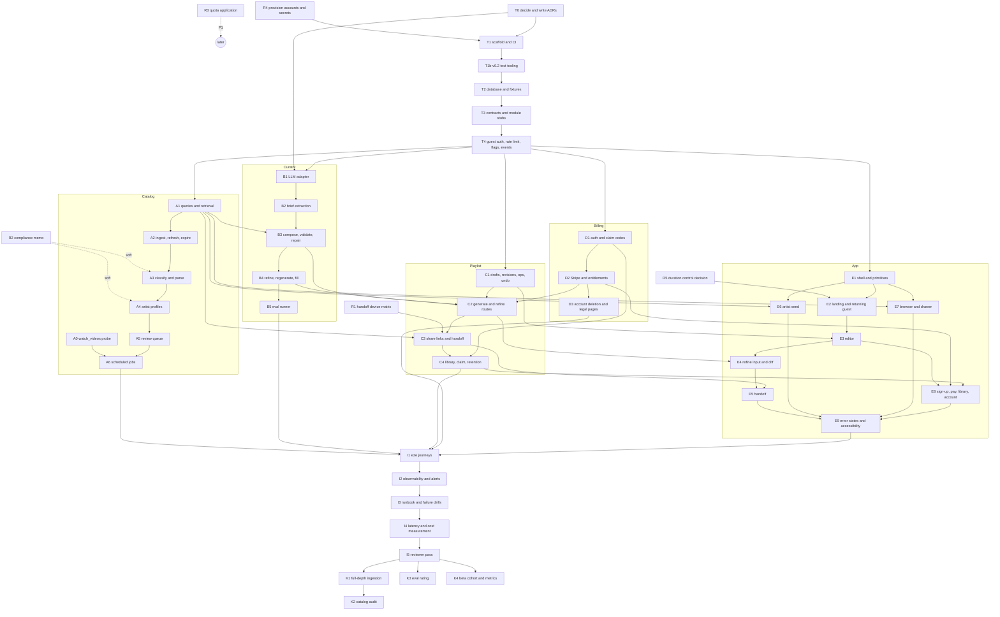

# Marquee TV: build plan

Nov 10, 2026 · Taylor Hickman · Version 0.6 · Status: Draft · Built from PRD v1.1, user journeys v0.2, architecture v0.2

**Changes in 0.6.** `card-review` is red until a review exists, so agents waiting on checks see it. 4.1 names the checks that count as CI and says every push needs a new review.

**Changes in 0.5.** The card's agent runs the card review itself, in a fresh subagent, before `hydra done` (4.1).

**Changes in 0.4.** A reviewer agent checks every code PR against its card before merge, not only once per milestone, and the required `card-review` status enforces it. B5 starts as soon as B4 merges. C2's entitlement tests carry `rule 3` in their names. CI fails a Playwright spec that passes only on retry. Section 6.3 describes the ruleset `main` has: pull requests only, no up-to-date rule, any merge method. The `migrations` job's drift check is gone from 6.3; it had nothing to compare against in the PR gate. Section 4 is current at `182508b` and lists the tasks the orchestrator ran outside the cards.

**Changes in 0.3.** Added card T1b for the test tooling that 0.2 added to T1 after T1 merged under 0.1. T2 now waits on T1b. Section 4 shows each card's status at `ef28c02` and the orchestrator's merge rules.

**Changes in 0.2.** Added section 6, testing and CI: test layers, shared test helpers and their owners, and the workflows that run them. T1 and T2 now build the full PR gate, the production deploy and migrations in CI. Every E card owns an `e2e/` folder. B3 and C3 add property tests, B5 owns the evals workflow, I1 owns the nightly journeys. A1 checks index use instead of wall-clock time. Open items moved to section 7.

## 1. How this plan works

The PRD's five phases (section 14) are paced for a human team. This plan re-cuts the same work for Claude Code agents run by an orchestrator. Two things decide the order: what must exist before a task can start, and which files a task may write. Agents working in parallel worktrees collide on shared files, so every card owns a disjoint set of paths and the shared ones (schema, contracts, tooling) land first.

Each task is a card in section 5. The card is the whole brief: an agent reads it, `CLAUDE.md`, section 6 of this plan, and the doc sections the card names, and nothing else is assumed. Cards have the same fields:

| Field | Meaning |
| --- | --- |
| Depends on | Cards that must be merged first. `M1` means every card in milestone 1 |
| Owns | Paths the agent may write. Everything else is read-only |
| Reads | PRD, architecture and journeys sections to read before starting. Section numbers, not summaries |
| Deliverable | What exists when the card is done |
| Done when | Checks that must hold. Commands where possible |
| Out of scope | The adjacent thing the agent will be tempted to build |

Every card is run by an agent. Some cards reach outside the repo: a phone, a third-party dashboard, policy text. The agent does what its tools reach, the card says what it produces for the rest and marks it unverified, and the downstream card names the default it takes when a result is missing.

`pnpm check` (format, typecheck, lint, unit and integration tests) is the gate on every card, plus `pnpm test:e2e` on cards with Playwright specs; the card lists what else must hold. Section 6 says where tests live, what they may touch and which workflow runs them. A reviewer subagent with a fresh context reviews every code PR against its card before merge (section 4.1), and runs once per milestone against the milestone's exit gate (section 2).

Status lives in the table in section 4. The orchestrator updates it; the cards do not change.

## 2. Milestones

| Milestone | What it produces | Exit gate | PRD phase |
| --- | --- | --- | --- |
| M0 Decisions and de-risk | ADRs written, including the two open choices; handoff tested on every surface a tool reaches; compliance memo; accounts and secrets provisioned | Every M0 card closed; ADRs 0001–0011 exist | 0 |
| M1 Foundation | Repo, tooling, CI, database with every table in architecture 5, shared contracts, module stubs, guest auth, rate limits, flags, events | `pnpm check` and `pnpm test:e2e` green in CI and required on `main`; local stack seeds 300 fixture performances; a preview deploy passes the smoke spec; a push to `main` migrates staging and deploys | 0–1 |
| M2 Lanes | Five lanes in parallel: catalog, curator, playlist API, billing and accounts, app UI | Every lane's cards merged; reviewer sign-off per lane | 1–3 |
| M3 Integration | End-to-end journeys, observability, alerts, runbook, latency and cost measured | A first-time user goes from landing to YouTube playing in under 60 s on a preview deploy; journeys pass on three consecutive nightly runs; p90 generation under 8 s; zero invalid IDs in 500 eval runs | 2–3 |
| M4 Beta | Catalog at full launch depth, eval ratings, invite cohort, metrics queries | 2,000+ eligible performances, under 2% misclassified in a 200-item audit; 45 of 50 eval prompts acceptable | 1, 4 |

Lanes in M2 start as soon as M1 merges and run concurrently. Within a lane, cards are ordered. Across lanes, the only couplings are through `src/contracts/`, which M1 fixes, and through the few cross-lane dependencies each card names.

## 3. Dependency graph

Soft dependencies: the card may start, but the earlier card's result can change its output. The card says what to do if it does.

## 4. Status

At `182508b`, Nov 10, 2026. `done #N` means merged in pull request N; `in progress #N` means pull request N is open.

| ID | Card | Milestone | Depends on | Status |
| --- | --- | --- | --- | --- |
| R1 | Handoff device matrix | M0 | | done #3; the test page is not on a preview URL |
| R2 | Compliance memo | M0 | | done #3 |
| R3 | Quota extension application | M0 | R4 | drafted #3; submitted after D3, when a live app exists |
| R4 | Provision accounts and secrets | M0 | | done #6, #7; T1b created the Vercel bypass secret |
| R5 | Duration control decision | M0 | | done #4 |
| T0 | Decide and write ADRs | M0 | | done #5 |
| T1 | Scaffold and CI | M1 | T0, R4 | done #2 against card 0.1; the 0.2 additions moved to T1b |
| T1b | v0.2 test tooling | M1 | T1 | done #12 |
| T2 | Database and fixtures | M1 | T1b | done #9; its 0.2 test tooling done as T2b, #14 |
| T3 | Contracts and module stubs | M1 | T2 | done #13 |
| T4 | Guest auth, rate limit, flags, events | M1 | T3 | done #20 |
| A0 | `watch_videos` probe | M2 | T1 | done #8 |
| A1 | Catalog queries and retrieval | M2 | M1 | done #25 |
| A2 | Ingest, refresh, expire | M2 | A1 | in progress #46 |
| A3 | Classify and artist parse | M2 | A2, B1, soft R2 | open |
| A4 | Artist profiles | M2 | A3, soft R2 | open |
| A5 | Review queue | M2 | A4 | open |
| A6 | Scheduled jobs | M2 | A5, A0 | open |
| B1 | LLM adapter | M2 | M1, T0 | done #22 |
| B2 | Brief extraction | M2 | B1 | done #33 |
| B3 | Compose, validate, repair | M2 | B2, A1 | done #42 |
| B4 | Refine, regenerate, fill the rest | M2 | B3 | in progress #50 |
| B5 | Eval runner | M2 | B4 | open |
| C1 | Drafts, revisions, ops, undo | M2 | M1 | done #23 |
| C2 | Generate and refine routes | M2 | C1, B4, D2 | open |
| C3 | Share links, redirect, handoff events | M2 | C1, A1, R1 | done #35 |
| C4 | Library, claim, retention | M2 | C3, D1 | done #41 |
| D1 | Auth and claim codes | M2 | M1 | done #24 |
| D2 | Stripe and entitlements | M2 | D1 | done #37 |
| D3 | Account deletion and legal pages | M2 | D2 | in progress #49 |
| E1 | App shell and primitives | M2 | M1 | done #26 |
| E2 | Landing and returning guest card | M2 | E1, R5 | done #32 |
| E3 | Editor | M2 | E2, C1 | done #44 |
| E4 | Refine input and diff | M2 | E3, C2 | open |
| E5 | Handoff | M2 | E4, C3 | open |
| E6 | Artist seed entry | M2 | E1, A1 | done #30 |
| E7 | Performance browser and drawer | M2 | E1, A1 | done #31 |
| E8 | Sign-up, pay, library, account | M2 | E3, D2, C4 | done #45 |
| E9 | Error states and accessibility | M2 | E5, E6, E7, E8 | open |
| I1 | End-to-end journeys | M3 | M2 | open |
| I2 | Observability and alerts | M3 | I1 | open |
| I3 | Runbook and failure drills | M3 | I2 | open |
| I4 | Latency and cost measurement | M3 | I3 | open |
| I5 | Reviewer pass | M3 | I4 | open |
| K1 | Full-depth ingestion | M4 | I5, R4 | open |
| K2 | Catalog audit | M4 | K1 | open |
| K3 | Eval rating | M4 | I5 | open |
| K4 | Beta cohort and metrics | M4 | I5 | open |

### 4.1 Merge rules

The orchestrator merges by these rules until this section changes. Section 6.3 describes the ruleset `main` has.

- `pnpm check` stays the gate on every card. A card runs it before handback, and the `check` job in `ci.yml` runs it in CI. New jobs run alongside it and never replace it, and `check` keeps its name, because the ruleset requires that name.
- A pull request merges only after the required `check`, `e2e` and `migrations` jobs and the `card-review` status have passed on its latest commit. A pending, skipped or failed one blocks the merge, and so does a red `main` (6.3).
- A pull request that changes anything outside `docs/` gets a card review once `check`, `e2e` and `migrations` pass, before `hydra done`. `card-review` is red, not pending, until a review exists: waiting for every check to pass waits forever. The card's agent runs it as a standing step, without asking: it starts a fresh subagent and gives it only the PR number, the card (or the task, for work outside the cards), `CLAUDE.md` and this section. The fresh context, which never saw the author's reasoning, is what makes the review independent; every comment posts as `taylor-hickman`. The reviewer reads the diff and checks three things: each "Done when" item holds and has a test; each test named `rule N` fails if the rule's enforcement is removed; nothing is written outside the card's "Owns" paths. It posts one PR comment whose first line is `Card review: <sha>`, naming the commit it read, with each finding as an unticked task-list item (`- [ ] ...`) and no task-list items when there are none. For each unticked item, the card's agent fixes it and pushes. Every push, a fix or a rebase, needs a new reviewer on the new head commit. The `card-review` status, set by `card-review.yml`, passes only when the latest such comment names the head commit and has no unticked item, and its description says what is missing. A finding the card's agent disputes goes to Taylor, who ticks it to override.
- B5 starts as soon as B4 merges, alongside C2. Until `evals.yml` runs, nothing checks the curator against the real model.
- The `main` ruleset requires pull requests, the `check`, `e2e` and `migrations` jobs, and the `card-review` status from GitHub Actions, and refuses deletion and force pushes. A card that would add any other required check or change another rule (up to date with `main`, merge method) asks Taylor first and changes the ruleset only after a yes. Until then its job runs on every pull request without being required.
- A task the orchestrator runs outside the cards gets a row in 4.2 when its pull request opens.
- The hold on T2 is over. T2 merged as #9, T1b as #12 and T2b as #14, so T3 and the cards after it run.

### 4.2 Tasks outside the cards

Fixes and wiring the orchestrator ran between cards, after M1. Pull requests that were Dependabot updates or status updates to this plan are left out.

| PR | Task | Status |
| --- | --- | --- |
| #21 | Stop preview-smoke running on `deploy.yml`'s staging job | done |
| #27 | Check the stored `ANTHROPIC_API_KEY` values inside a deployment | done |
| #28 | Catalog reads leave out flagged and rejected rows | done |
| #29 | Custom SMTP for Supabase Auth email links | done |
| #34 | `db.test.ts` runs on the worktree's own test database | done |
| #36 | e2e reset keeps the `handoff_mode` flag row | done |
| #39 | Run `billing.expirePasses` on a schedule | done |
| #40 | Let Stripe's preview webhook reach a preview running current code | done |
| #43 | Wire the claim code into sign-in so `claimGuestDrafts` runs | done |
| #47 | Point playlist's draft view at `catalog.performanceCards` and `billing.canRunCurator` | done |
| #48 | Catalog `briefContext()` and wire `curator.generate` | in progress |
| #51 | Artist entry saves its seeds as the pending brief | in progress |
| #62 | PRD 9.1 rules the Tiny Desk Meets festival sets out of the catalog | in progress |

## 5. Cards

### M0 Decisions and de-risk

#### R1 · Handoff device matrix

- Owns: `docs/architecture/handoff-tests.md`, `scripts/probe/handoff-page/**`
- Reads: PRD 7.5, 14 (Phase 0); journeys J5, J9; architecture 7.2
- Deliverable: a static test page with three buttons (open a `watch_videos` URL, open it from the third track, follow a `302` to it) deployed to a preview URL. A table in `docs/architecture/handoff-tests.md` with one row per surface (desktop browser, iOS Safari, Android Chrome, cast to TV, Instagram in-app browser) and three columns: `watch_videos` opens and plays; play from here resumes at the chosen track; the `302` lands in the YouTube app. Desktop is run with Playwright. iOS and Android are run in the iOS Simulator and an Android emulator when either is installed on the machine. Every other cell is marked unverified with the exact taps to verify it.
- Done when: every cell is pass, fail or unverified with steps. The `302` column decides C3: redirect only when iOS and Android both pass; the tap-to-open page otherwise, including when either is unverified.

#### R2 · Compliance memo

- Owns: `docs/architecture/compliance-memo.md`
- Reads: PRD 12; architecture 5.3, 6.1, 8 (classify row), 12 rows 8 and 17; the current YouTube API Services Terms of Service and Developer Policies, fetched, not recalled
- Deliverable: a memo answering, with the policy clause quoted beside each answer: the retention window for `performance_yt_cache` rows; whether model-generated artist profiles keyed by names parsed from API titles are acceptable; whether the four-value `kind` column is acceptable. Each answer is yes, no, or unclear with the clause that makes it unclear. The memo header says it is an agent's reading of the policies and names the clauses a lawyer should confirm.
- Done when: all three answered with citations. A2 takes the retention window. If profiles are no, A4 switches to request-time similarity lookups with a cache and B3's latency budget is revisited. Unclear counts as yes for A3 and A4, and the memo lists it under clauses to confirm.

#### R3 · Quota extension application

- Depends on: R4
- Owns: `docs/architecture/quota-application.md`
- Reads: PRD 10.2, 12, 14; Google's YouTube API Services quota extension form, fetched
- Deliverable: the application text for every field of the form, written from the PRD and the compliance memo, in the doc. Submitted through the Google Cloud project from R4 when a browser tool with that account is available; the doc records the submission date and case ID. Without browser access, the doc holds the ready-to-paste text and says so.
- Done when: the doc is complete and either records the submission or says what blocked it. Gates P1 only; nothing in this plan waits on approval.

#### R4 · Provision accounts and secrets

- Owns: `.env.example`, `docs/ops/provisioning.md`, `scripts/provision/**`
- Reads: architecture 9.2 (secrets), 9.4
- Deliverable: Vercel project linked to the GitHub repo; Supabase staging and production projects; Stripe account in test mode with a session pass price and a monthly subscription price; Sentry project; Google Cloud project with the YouTube Data API enabled and one API key; a Google OAuth client for Supabase Auth. Each done through its CLI (`vercel`, `supabase`, `stripe`, `sentry-cli`, `gcloud`, `gh`) where the CLI is authenticated. Secrets set in Vercel and in GitHub Actions environments named `staging` and `production`; the PR gate gets none (section 6.1). A Vercel protection bypass secret for automation, stored in GitHub Actions, so workflows can reach preview deploys. Names of every secret listed in `.env.example` with no values. Where a CLI needs an interactive login or a dashboard step with no CLI, `scripts/provision/wizard.sh` walks through exactly that step and `docs/ops/provisioning.md` lists what remains.
- Done when: `.env.example` lists every variable; `scripts/provision/verify.sh` confirms each exists in Vercel and GitHub Actions, or prints the ones missing and the wizard step that sets them.

#### R5 · Duration control decision

- Owns: `docs/design/mockups.html` (duration control only), `docs/product/prd.md` section 18.2 (one checkbox)
- Reads: PRD 7.1, 18.2 (duration control); journeys 5.2; CLAUDE.md "Where the truth lives"
- Deliverable: the PRD specifies presets (30 min, 1 h, 2 h, 3 h, custom) and the mockups show a stepper. The PRD wins. The mockups change to presets, the 18.2 item is checked off with a one-line note, and the handback says what the stepper did better, if anything, for the design spec to weigh later.
- Done when: PRD and mockups agree and 18.2 is closed.

#### T0 · Decide and write ADRs

- Owns: `docs/architecture/decisions/**`, `docs/architecture/architecture.md` section 13 (two rows)
- Reads: architecture 6.2 (token budget), 6.4, 9.4, 12, 13, and the section each ADR names; `docs/README.md` for the file naming rule; current provider pricing and model pages, fetched
- Deliverable: eleven files `0001-url-handoff-export.md` through `0011-branded-share-links.md`, each with Context, Decision, Consequences, Status accepted, and the architecture sections it draws from. Nine take their decision from the architecture doc as written. Two are open and this card decides them: ADR 0006 picks Drizzle unless the agent finds a reason in the Supabase CLI docs that it fits the 9.4 environments better, and says why; ADR 0008 picks a provider and a small and main model that meet 6.4's requirements (structured output, streaming, prompt caching, p90 under 5 s at about 6,000 input tokens), and shows the cost per generation from the 6.2 token budget at fetched prices against the $0.05 cap. The Claude 5.5 Haiku and Sonnet pair is the default to beat. Both decisions are appended to section 13.
- Done when: eleven files exist; ADR 0008 shows the arithmetic; `docs/README.md` ADR row updated to list them.
- Out of scope: decisions beyond those two. A gap in the docs is a question in the handback.

### M1 Foundation

#### T1 · Scaffold and CI

- Depends on: T0, R4
- Owns: root config files (`package.json`, lockfile, `tsconfig.json`, ESLint, Prettier, Vitest and Playwright configs, `.nvmrc`, `.env.example`), `.github/**`, `src/test/setup.ts`, `e2e/support/**`, `e2e/smoke/**`, `src/app/layout.tsx`, `src/app/page.tsx` (placeholder)
- Reads: architecture 3, 9.4, 10; this plan, section 6
- Deliverable: Next.js app with TypeScript strict, pnpm pinned through `packageManager`, Node pinned in `.nvmrc`, ESLint, Prettier. Every test tool in 6.1 installed and configured: Vitest with the network guard and the coverage thresholds, Playwright with an axe helper and a `live` project, and one smoke spec that loads the placeholder page with zero axe violations. Scripts `pnpm check`, `pnpm test:e2e` and `pnpm test:live`. ESLint `no-restricted-imports` holding architecture 3's boundaries: modules import each other only through `index.ts`, and nothing under `src/modules/curator/**` imports `src/lib/db`. `ci.yml` (`check`, `e2e`, `actionlint`), `preview-smoke.yml` and `dependabot.yml` per 6.3, and the `main` ruleset set through `gh api`. Vercel previews through its Git integration. `.env.example` from R4 plus the test-only variables in 6.1. The directory layout from architecture 10 exists as empty folders with a `README.md` of one line each.
- Done when: `pnpm check` and `pnpm test:e2e` pass locally and in CI on the PR; a test that fetches `https://example.com` fails; importing `src/lib/db` from a file under `src/modules/curator/` fails lint; `preview-smoke.yml` passes against the Vercel preview; a direct push to `main` is refused.
- Out of scope: any product code, database, or UI beyond the placeholder. The database steps in CI (T2).

#### T1b · v0.2 test tooling

T1 merged as pull request #2 against this plan's 0.1 card. Version 0.2 then widened T1's deliverable. This card builds what 0.2 added and #2 did not.

- Depends on: T1
- Owns: T1's paths except `src/app/**`, plus `.nvmrc` and, in `.env.example`, the test-only variables and the bypass secret's name. Not the database steps or the `migrations` job in `ci.yml`, which are T2's.
- Reads: architecture 3, 10; this plan, sections 4.1 and 6; `docs/ops/provisioning.md`
- Deliverable, measured against `main` at `11bb638`:
  - `.nvmrc` pinning Node 24.
  - The test dependencies 6.1 lists that are not installed: `@vitest/coverage-v8`, `@axe-core/playwright`, MSW, fast-check.
  - `src/test/setup.ts`, loaded by `vitest.config.mts`, which fails any request to a host other than localhost. Coverage reported on every run, with 6.1's four branch thresholds on their paths. None of those paths exist yet, so each threshold starts to apply when its files land.
  - `playwright.config.ts` serving `next build && next start` instead of `pnpm dev`, two retries in CI with a trace on the first retry, a base URL that can be overridden from the environment, and a `live` project. An axe helper in `e2e/support/`. `e2e/smoke/` with one spec that loads `/` and finds zero axe violations. A `pnpm test:live` script.
  - ESLint `no-restricted-imports` holding architecture 3's boundaries: modules import each other only through `index.ts`, and nothing under `src/modules/curator/**` imports `src/lib/db`.
  - In `ci.yml`: an `e2e` job (build, Playwright, report and traces uploaded on failure, `stripe-mock` as a service, `LLM_ADAPTER=fake` and `STRIPE_API_BASE` set), an `actionlint` job when `.github/**` changes, `concurrency` cancelling superseded runs, and caches for the pnpm store and Playwright browsers. The `check` job keeps its name and still runs `pnpm check`.
  - `preview-smoke.yml`, triggered by a successful Vercel `deployment_status` on a pull request, running `e2e/smoke` against the preview URL with the protection bypass header.
  - `dependabot.yml` per 6.3.
  - The Vercel Protection Bypass for Automation secret, which R4 did not create (`docs/ops/provisioning.md` lists it as a remaining step), stored as a GitHub Actions repository secret. If the Vercel or GitHub CLI is not authenticated, the card stops and asks.
  - `LLM_ADAPTER` and `STRIPE_API_BASE` in `.env.example` as test-only variables.
  - A proposal to add `e2e` to the `main` ruleset's required checks. Per 4.1 the card asks Taylor and changes the ruleset only after a yes. The handback says which way it went.
- Done when: `pnpm check` and `pnpm test:e2e` pass locally and in CI on the PR; a test that fetches `https://example.com` fails; importing `src/lib/db` from a file under `src/modules/curator/` fails lint; `preview-smoke.yml` passes against the PR's Vercel preview; `actionlint` passes; a direct push to `main` is refused.
- Out of scope: the database steps, the `migrations` job, `deploy.yml` and `vercel.json` (T2). B1's fake adapter (this card sets the variable, and B1 writes the adapter). Ruleset changes Taylor has not agreed to. 6.3's squash-only rule in particular stays off until Taylor decides, because Hydra merges this repo with merge commits.

#### T2 · Database and fixtures

- Depends on: T1, T1b
- Owns: `db/**`, `src/lib/db/**`, `supabase/**`, `scripts/seed/**`, `src/test/db.ts`, `src/test/factories/**`, `e2e/support/db.ts`, `.github/workflows/ci.yml` (database steps and the `migrations` job), `.github/workflows/deploy.yml`, `vercel.json`
- Reads: architecture 4, 5 (all of it), 9.2 (first bullet), 9.4; ADR 0006; this plan, section 6
- Deliverable: Supabase CLI local stack configured. Migrations for every table in architecture 5.1, 5.2 and 5.4 with the constraints the text names: exactly one owner on `playlist_draft`, at most one `free` draft per owner, `(draft_id, number)` primary key on revisions, unique `video_id`, hashed `guest.token_hash`. `performance_tag` created empty. Full-text and `pg_trgm` indexes from 5.1. Row-level security on with no policies. A server-only db client in `src/lib/db`. A fixture of about 300 performances across three publishers and six series with synthetic video IDs and plausible artists, loaded by `pnpm seed`. The test database from 6.1, isolated per Vitest worker and per worktree and built from the migrations in the checkout. A factory per table that returns a valid row and takes overrides. `e2e/support/db.ts` resetting and seeding the stack before a Playwright run. In CI, `check` and `e2e` start the local stack with only the services tests use (Postgres, Auth, REST, mail), and the `migrations` job runs and joins the required checks. `deploy.yml` and `vercel.json` per 6.3.
- Done when: `pnpm db:reset && pnpm seed` leaves 300 rows in `performance` with matching `performance_yt_cache` rows; a test proves the anon key reads zero rows from every table; `pnpm check` passes in two worktrees run at the same time; the migration-edit check fails on a local branch that edits a migration from `main`; a push to `main` migrates staging and production and deploys; `pnpm check` green.
- Out of scope: queries beyond the client, any ingestion, any API route.

#### T3 · Contracts and module stubs

- Depends on: T2
- Owns: `src/contracts/**`, `src/modules/*/index.ts`, `src/modules/*/types.ts`
- Reads: architecture 5.2 (`items` shape), 6.2 step 1 (brief shape), 6.3 (ops), 9.1 (every route and the `baseRevision` rule); PRD 7.4
- Deliverable: Zod schemas for every request and response body in architecture 9.1, the brief, revision items, ops (`add`, `remove`, `replace`, `move`, `pin`, `unpin`, `rename`), curator output, and stream events. Every module in architecture 10 exports a typed interface in `index.ts` with function signatures and bodies that throw `NotImplemented`. Where a lane calls another (curator calls catalog retrieval, playlist calls curator and billing), the call shape is fixed here. One valid example per schema exported from `src/contracts/examples.ts`, for tests and for UI mocks (6.1).
- Done when: every route in 9.1 has a request and response schema; every stub compiles; a test parses every schema's example from `examples.ts` and rejects one invalid example per schema; `pnpm check` green.
- Out of scope: any implementation. The stubs exist so five lanes can compile against the same shapes.

#### T4 · Guest auth, rate limit, flags, events

- Depends on: T3
- Owns: `src/lib/auth/**`, `src/lib/rate-limit/**`, `src/lib/flags/**`, `src/modules/events/**`, `src/app/api/events/**`
- Reads: architecture 4 (guest identity, claiming), 5.4 (`guest`, `event`, `app_flag`), 9.2 (tokens, rate limits), 9.3; journeys 6
- Deliverable: issue a 128-bit guest token, store its hash, verify in constant time, attach `guest` to the request. Assign `cohort` at creation. A `requireOwner(draft)` helper that accepts either the guest token or a Supabase session. Rate limits counted from `curator_run` and `guest` rows per IP hash, guest and user, with the limits from 9.2 as constants. `getFlag(key)` over `app_flag` with `handoff_mode` seeded to `url`. `events.write(name, props)` and `POST /api/events` with a plain per-IP limit and a schema that accepts only the event names in journeys 6. `src/lib/auth/testing.ts` with `asGuest()` and `asUser()`, which create the owner and return the request headers a route handler test needs.
- Done when: tests cover token issue and verify, a wrong token rejected, the rate limit refusing the eleventh run in an hour, an unknown event name rejected; `pnpm check` green.
- Out of scope: sign-in (D1), claiming drafts (C4).

### M2 Lane A · Catalog

#### A0 · `watch_videos` probe

- Depends on: T1
- Owns: `scripts/probe/**`, `docs/architecture/handoff-tests.md` (one section, "Non-browser response")
- Reads: architecture 8 (`check-handoff` row and the paragraph after the table), 14 (third bullet)
- Deliverable: a script that fetches `https://www.youtube.com/watch_videos?video_ids=` with three known IDs using plain `fetch`, records status, redirect chain and whether a `list=` parameter appears, then does the same with Playwright. Findings written to the doc.
- Done when: the doc says whether plain `fetch` is enough for `check-handoff` or Playwright is needed. A6 reads this.
- Out of scope: the scheduled job itself.

#### A1 · Catalog queries and retrieval

- Depends on: M1
- Owns: `src/modules/catalog/**`, `src/app/api/catalog/**`
- Reads: architecture 5.1, 6.1 (influence-only artists), 6.2 step 2, 6.3 (Replace one), 9.1 (catalog routes), 9.2 (rate limit on search); PRD 7.2, 7.3, 13 (300 ms)
- Deliverable: `search(query, filters)` over full-text title and artist with publisher, series and artist filters; `artistTypeahead(prefix)` over names and aliases with `pg_trgm`; `retrieveCandidates(brief, state)` in SQL following step 2's order (seeds, similar artists, profile matches within the curve's energy range), filtered by series constraints, exclusions, removals, `eligible AND available`, capped at 150, with "surprise me" widening and `prefer_unfamiliar` reordering; `replaceOptions(draft, index)` returning three per 6.3. Routes `GET /api/catalog/search` and `GET /api/catalog/artists`.
- Done when: tests against the fixture cover each retrieval tier, the cap, exclusion and removal filtering, the three replace options matching energy within 1 and duration within 30%; on a generated 5,000-row catalog, `EXPLAIN` shows search using the full-text index and typeahead using the trigram index (I4 measures the 300 ms on staging); `pnpm check` green.
- Out of scope: anything that calls a model. Ingestion.

#### A2 · Ingest, refresh, expire

- Depends on: A1
- Owns: `scripts/ingest/**`, `src/modules/catalog/youtube/**`
- Reads: architecture 5.3, 8 (`ingest:new`, `refresh`, `expire` rows); PRD 9.2, 9.3, 12
- Deliverable: a YouTube Data API client limited to `playlistItems.list` and `videos.list`. `ingest:new` pages each series' uploads playlist until known IDs, writes `performance` rows with `review_status = pending` and `performance_yt_cache` rows with `fetched_at`. `refresh` re-fetches cache rows, flips `available`, sets `last_verified_at`. `expire` deletes cache rows past the retention window (a constant, default 30 days until R2 sets it) and marks those performances ineligible. API responses recorded as fixtures under `src/modules/catalog/youtube/fixtures/` so tests run without a key.
- Done when: tests run all three jobs against recorded responses and check row counts, `available` flips and expiry; one real run against a single series with the R4 key writes rows and a short note of unit cost to the handback; `pnpm check` green.
- Out of scope: classification, artist parsing, schedules.

#### A3 · Classify and artist parse

- Depends on: A2, B1; soft R2
- Owns: `scripts/ingest/classify/**`, `src/modules/catalog/classify/**`
- Reads: architecture 5.1 (`series.title_rule`, `kind`, `review_status`), 8 (`classify` row), 9.2 (third bullet); PRD 9.2, 9.3, 12
- Deliverable: per-series title rules that set `kind` and parse artists without a model call where they can. For titles the rule cannot decide, one call through the B1 adapter that returns `kind` only, and a second that returns an artist name which must match one of the parser's candidates or the row is flagged. `eligible` derived from `kind`. New artists created with aliases; unsure parses set `review_status = flagged`.
- Done when: tests cover a rule-decided title, a model-decided title with a mocked adapter, and an injected title that cannot escape the enum; the fixture's 300 titles classify with under 2% flagged; `pnpm check` green.
- Out of scope: profiles. If R2 rejects the four-value `kind`, collapse to a boolean in a follow-up card; build with four values now.

#### A4 · Artist profiles

- Depends on: A3; soft R2
- Owns: `scripts/ingest/profile/**`, `src/modules/catalog/profile/**`
- Reads: architecture 5.1 (`artist_profile`), 6.1, 8 (`profile` row); PRD 8.1, 8.3
- Deliverable: for each artist without a profile, one structured call through B1 returning genres, scenes, era, energy 1 to 5 and similar artist names. Similar names resolved to catalog artist IDs through aliases; unresolved names dropped. `source = model`; editor rows (`source = editor`) are never overwritten.
- Done when: tests with a mocked adapter cover a new artist, an editor row left alone, and a similar-artist name that does not resolve; the fixture's artists all have profiles after one run; `pnpm check` green.
- Out of scope: using profiles (A1 already does). If R2 rejects profiles, the handback names the request-time fallback from architecture 14 and this card is reopened.

#### A5 · Review queue

- Depends on: A4
- Owns: `db/views/**`, `scripts/ingest/audit/**`, `docs/ops/review-queue.md`
- Reads: architecture 8 (`audit-sample` row and Review queue paragraph); journeys J15; PRD 9.3
- Deliverable: SQL views `flagged_artists`, `flagged_kinds`, `audit_sample`. The `audit-sample` job flags a 10% random sample of rows new since the last run. A one-page procedure for working the queue in Supabase Studio: what each view shows, how to accept, correct or reject a row, how to set an editor profile.
- Done when: views exist as a migration; a test proves the sample is about 10%; the procedure covers every `review_status` transition; `pnpm check` green.
- Out of scope: an admin UI.

#### A6 · Scheduled jobs

- Depends on: A5, A0
- Owns: `.github/workflows/ingest-*.yml`, `.github/workflows/check-handoff.yml`, `scripts/ingest/check-handoff/**`
- Reads: architecture 8 (whole table), 9.3 (alerts); journeys J16; ADR 0005
- Deliverable: workflows on the schedules in the table: nightly `ingest:new` then `classify` then `profile` then `expire`; weekly `refresh` and `audit-sample`; daily `check-handoff`. `check-handoff` uses plain `fetch` or Playwright per A0's finding and fails the workflow when no `list=` parameter appears. Failure of any workflow notifies the channel named in ADR 0005.
- Done when: `act` or a manual `workflow_dispatch` runs each workflow green against staging; `check-handoff` fails when pointed at a URL with no `list=`; `pnpm check` green.
- Out of scope: flipping `handoff_mode` automatically. That is a runbook step (I3), run on call.

### M2 Lane B · Curator

#### B1 · LLM adapter

- Depends on: M1, T0
- Owns: `src/modules/curator/llm/**`
- Reads: architecture 6.4, 6.2 (token budget); PRD 8.5; ADR 0008
- Deliverable: `extractBrief(input, schema)` and `compose(input, schema)` behind one file, each returning parsed output or a typed error (`schema`, `timeout`, `provider`). Prompt caching on the fixed system prompt. Each call records model, tokens in and out, and latency to a `CallRecord` the caller writes to `curator_run`. A fake adapter in `fake.ts` that returns canned or recorded output, selected when `LLM_ADAPTER=fake` so e2e runs need no key. The app refuses the fake when `VERCEL_ENV=production`. Retry once on a schema failure.
- Done when: tests cover a valid response, a schema failure retried once then surfaced, a timeout, token accounting, and the fake refused in production; one real call per function against the chosen models succeeds and the handback reports measured latency and tokens; `pnpm check` green.
- Out of scope: prompts. Anything catalog.

#### B2 · Brief extraction

- Depends on: B1
- Owns: `src/modules/curator/brief/**`
- Reads: architecture 6.2 step 1, 6.3 (refine row: brief delta and edit scope); PRD 7.1 (chips), 7.4 (five instruction types), 18.1 (typed duration wins)
- Deliverable: the brief schema from T3 filled by one small-model call: energy curve segments, genres, scenes, seed IDs, `series_include` and `series_exclude`, `novelty`, exclusions, duration in seconds. Mood chips map to prompt text. A typed duration overrides the control. Influence-only artists get genres, scenes and energy in the brief. For refine, the same call returns a delta and an edit scope against the current brief and list.
- Done when: a test file of at least 30 prompts covering each of the five instruction types and each chip produces a parsed brief with the expected curve shape and series constraints, run against the fake adapter with recorded real outputs; `pnpm check` green.
- Out of scope: retrieval, composition.

#### B3 · Compose, validate, repair

- Depends on: B2, A1
- Owns: `src/modules/curator/compose/**`, `src/modules/curator/validate/**`, `src/modules/curator/generate.ts`
- Reads: architecture 6.2 steps 2 to 5 (validate and repair in full), 6.3 (pins paragraph and the "drop Khruangbin" rule); PRD 4.5, 4.6, 7.4, 8.4
- Deliverable: `generate(state)` running brief, retrieval, compose, validate, repair and returning a proposed revision with warnings. Candidates go to the model as `id, artist, series, duration_s, artist_energy, genres` only. The repair step in code: drop IDs outside the candidate set and log them; restore pins to their positions; apply removals and exclusions; at most two per artist, no duplicates; must-include seeds present or a gap warning; duration to target ±10% by adding or dropping the best energy match; schema failure retried once then `generation_failed` with the draft untouched. An unpin or remove on a pinned item is allowed only when the instruction names that artist.
- Done when: unit tests, each with a fake adapter output designed to break one rule: an invented ID, a moved pin, a removed ID returned, three of one artist, a duration 30% off, a missing seed, a pin removed without naming the artist, a pin removed with the artist named. Every test asserts the repaired output and the warning. A fast-check property test: for any composer output drawn from the candidates plus invented and duplicate IDs, with any pins and removals, the repaired list holds only candidate IDs, every position pin at its index, no removed ID, and at most two per artist. `pnpm check` green.
- Out of scope: writing revisions (C2 does that), streaming.

#### B4 · Refine, regenerate, fill the rest

- Depends on: B3
- Owns: `src/modules/curator/refine.ts`, `src/modules/curator/regenerate.ts`, `src/modules/curator/fill.ts`
- Reads: architecture 6.3 (whole table and the cap paragraph); PRD 7.3 (fill), 7.4, 8.5 (25-run cap)
- Deliverable: `refine(state, instruction)` returning ops against the current list, validated as in B3. `regenerate(state)` with pins fixed and brief extraction skipped unless the brief changed. `fill(state)` treating manual picks as inclusion pins. All three return a proposed revision with `trigger` set.
- Done when: tests cover each: a refine that moves a pinned item is rejected, a regenerate keeps every pin in place, a fill places inclusion pins anywhere but keeps them; `pnpm check` green.
- Out of scope: routes, the 25-run cap itself (C2 enforces it from `curator_run` counts).

#### B5 · Eval runner

- Depends on: B4
- Owns: `scripts/evals/**`, `docs/evals/prompts.md`, `.github/workflows/evals.yml`
- Reads: architecture 6.5; PRD 14 (Phase 2 exit gate); this plan, 6.3
- Deliverable: 50 prompts in `docs/evals/prompts.md` spread across the chips, artist seeds, durations and the five instruction types, each with a one-line expectation a rater can judge. `pnpm evals` runs every prompt through `generate` against the staging catalog with the real adapter, writes `evals/results/<date>.json`, and checks mechanically: zero IDs outside the candidate set, pins intact, duration in range, artist cap held. Exits non-zero on any violation. A `--runs N` flag repeats for the 500-run check. `evals.yml` per 6.3, writing the invariant summary to the run's job summary.
- Done when: `pnpm evals --runs 1` completes against staging with zero invariant failures and the results file lists latency and token totals per run; `evals.yml` passes on a manual dispatch and fails when one result is edited to hold an invented ID; `pnpm check` green.
- Out of scope: the rating (K3).

### M2 Lane C · Playlist API

#### C1 · Drafts, revisions, ops, undo

- Depends on: M1
- Owns: `src/modules/playlist/**`, `src/app/api/drafts/route.ts`, `src/app/api/drafts/[id]/route.ts`, `src/app/api/drafts/[id]/ops/**`, `src/app/api/drafts/[id]/undo/**`
- Reads: architecture 4, 5.2, 7.1 steps 1 to 2, 9.1 (`baseRevision` and `409`); PRD 7.4, 7.6; journeys J2, J6, J11
- Deliverable: `POST /api/drafts` creating a draft (and a guest when there is no token). `GET /api/drafts/:id` returning the current revision, flags and entitlement state. `POST /ops` applying manual ops to a new revision: pin, unpin, remove, move, add, rename, with manual adds recorded `pinned: include, source: manual` and position pins set only when the person moves a row. `POST /undo` writing a copy of revision n−1. Every write checks `baseRevision` and returns `409` with the current revision on mismatch. `read_only` blocks ops and undo.
- Done when: tests cover each op, undo of a removal un-removing it, a stale `baseRevision` getting `409`, a `read_only` draft refusing ops, a wrong owner getting `404`; `pnpm check` green.
- Out of scope: model-backed runs, share links, library.

#### C2 · Generate and refine routes

- Depends on: C1, B4, D2
- Owns: `src/app/api/drafts/[id]/generate/**`, `src/app/api/drafts/[id]/refine/**`, `src/app/api/drafts/[id]/replace-options/**`, `src/modules/playlist/runs.ts`
- Reads: architecture 4 (what the free limit counts), 6.2 (sequence, latency budget, disconnects), 6.3 (cap paragraph), 7.1 step 3, 7.3 steps 1 and 5 and the entitlement table, 9.1; PRD 7.6, 8.5, 13
- Deliverable: streamed `POST /generate` and `POST /refine`. Order per request: owner, `baseRevision`, rate limit, entitlement. A guest's first model-backed draft becomes `free`; any other draft without an entitlement gets `402`, `status = awaiting_payment`, brief held on the draft. Over 25 runs returns a typed error that leaves manual edits working. Stream events: `started`, `brief`, `candidates`, `result` or `error`, with `started` sent before any model call. The run finishes and writes revision plus `curator_run` in one transaction even when the client disconnects. A 20 s ceiling, injected so tests set it to milliseconds, returns `generation_failed`. `GET /replace-options?index=` calls A1 with no entitlement check.
- Done when: tests cover the free draft, the `402` on a second draft, a pass holder on and off their draft, a subscriber, the run cap, the `409`, a disconnect still writing the revision, and `started` arriving before the fake adapter is called; the `402` test and a test that `replace-options` answers without an entitlement carry `rule 3` in their names; `pnpm check` green.
- Out of scope: UI, payment flows.

#### C3 · Share links, redirect, handoff events

- Depends on: C1, A1, R1
- Owns: `src/app/api/drafts/[id]/share-link/**`, `src/app/s/[code]/**`, `src/modules/playlist/handoff.ts`, `src/lib/handoff-url.ts`
- Reads: architecture 5.2 (`share_link`, `handoff_event`), 7.2, 9.1, 9.2 (`/s/:code` limit); PRD 7.5; journeys J5, J9, 6; R1's table
- Deliverable: a pure function building `watch_videos` URLs from an ordered ID list and a start index, split into parts of at most 50, shared by client and server. `POST /share-link` idempotent on (draft, revision, start index) returning a short code. `GET /s/:code` logging `share_link_opened` then, per R1: a `302` to the YouTube URL, or a minimal page with one tap-to-open button. `handoff_event` written from `POST /api/events` with `type`, `part`, `start_index`, `surface`.
- Done when: tests cover a 120-item list splitting into three parts, play-from-here slicing before splitting, a fast-check property test that for any list and start index the parts concatenated equal the slice and no part holds more than 50 IDs, idempotent codes, the redirect or page per R1, the per-IP limit; `pnpm check` green.
- Out of scope: the handoff UI (E5), the flag read (E5 reads `handoff_mode` from `GET /api/drafts/:id`).

#### C4 · Library, claim, retention

- Depends on: C3, D1
- Owns: `src/app/api/library/**`, `src/modules/playlist/claim.ts`, `scripts/retention/**`, `.github/workflows/retention.yml`
- Reads: architecture 4 (claiming, retention), 7.3 step 3, 9.1 (`/api/library`); PRD 7.6; journeys J7, J8
- Deliverable: `claimGuestDrafts(claimCode, userId)` moving every draft from the guest to the user in one transaction and carrying `cohort`. `GET /api/library` listing the user's drafts with title, runtime, status and last revision time. A nightly job deleting unclaimed guest drafts 30 days after last activity, keeping `curator_run` rows with `draft_id` nulled.
- Done when: tests cover a claim moving three drafts and the cohort, a second claim with the same code failing, retention deleting a 31-day draft and keeping its runs; `pnpm check` green.
- Out of scope: sign-in itself (D1).

### M2 Lane D · Billing and accounts

#### D1 · Auth and claim codes

- Depends on: M1
- Owns: `src/lib/auth/supabase/**`, `src/app/api/auth/**`, `src/app/auth/**`, `src/modules/billing/users.ts`
- Reads: architecture 4 (claiming), 5.4 (`app_user`), 7.3 step 2, 9.2; PRD 7.7 (Sign-up and pay row), 12, 18.1 (Accounts in P0); ADR 0007
- Deliverable: Supabase Auth with Google (basic profile scope) and email magic link. On first sign-in, create `app_user`. The sign-in start accepts a guest token and mints a one-time claim code bound to that guest, carried through the magic link or OAuth state, so a different browser still claims. `requireOwner` from T4 extended to accept a session. The claim call itself is C4's; D1 exposes `consumeClaimCode(code)` returning the guest ID once.
- Done when: tests cover user creation on first sign-in, a claim code consumed once, a reused code rejected, a session passing `requireOwner` on a claimed draft; a manual sign-in through each provider works on a preview deploy; `pnpm check` green.
- Out of scope: payments, the sign-up UI.

#### D2 · Stripe and entitlements

- Depends on: D1
- Owns: `src/modules/billing/**` (except `users.ts`), `src/app/api/billing/**`, `src/app/api/webhooks/stripe/**`
- Reads: architecture 5.4 (`entitlement`), 7.3 steps 3 to 5, the entitlement table and Account management; PRD 16.1, 16.3, 18.1 (Session pass after day 7, Wallet payments); ADR 0007, 0010
- Deliverable: `POST /api/billing/checkout` creating a Checkout session for a one-off pass or a monthly subscription with wallet payments on, bound to the held draft. `POST /api/webhooks/stripe` verifying signatures and handling `checkout.session.completed`, `invoice.paid`, `customer.subscription.updated` and `.deleted` as the only writer of `entitlement`. On a new entitlement, set the held draft `active` and bind a pass to it. `canRunCurator(owner, draft)` implementing the table in 7.3. A job or query flipping pass drafts to `read_only` at `period_end`. `POST /api/billing/portal` returning a Customer Portal URL. `src/modules/billing/testing.ts` building signed webhook events from Stripe's fixtures. The Stripe client honours `STRIPE_API_BASE` so e2e runs go to `stripe-mock`.
- Done when: tests with Stripe's test fixtures cover each webhook event, an unsigned webhook rejected, every row of the entitlement table, and a pass draft becoming `read_only` after seven days; a test-mode checkout on a preview deploy produces an entitlement; `pnpm check` green.
- Out of scope: the plan screen (E8), refunds (PRD 18.2, still open).

#### D3 · Account deletion and legal pages

- Depends on: D2
- Owns: `src/app/api/account/**`, `src/app/privacy/**`, `src/app/terms/**`, `docs/legal/**`
- Reads: architecture 4 (retention), 7.3 (Account management), 9.1; PRD 12, 13 (privacy row); journeys J10
- Deliverable: `DELETE /api/account` cancelling any active subscription at Stripe, deleting the user, entitlements, drafts, revisions and share links, and keeping `curator_run` rows with `draft_id` nulled. Static `/privacy` and `/terms` pages rendering Markdown from `docs/legal/`, with draft text that states what is collected (guest token, drafts, events, email on sign-in), what comes from the YouTube API and how long it is kept, and payment handling by Stripe. The handback marks the text as not yet reviewed by counsel.
- Done when: a test deletes an account and asserts every table; both pages render on a preview deploy; `pnpm check` green.
- Out of scope: legal sign-off. The text is a draft until counsel approves it.

### M2 Lane E · App UI

Reads for every E card: `docs/design/mockups.html` for the look; journeys 5.1 for screens and states the mockups lack; `CLAUDE.md` UI copy rule.

Every E card owns the `e2e/<area>/` folder named in its Owns line and puts its Playwright specs there. Specs run in the PR gate under 6.1's e2e rules: routes not yet merged are mocked with T3 examples, and every spec ends with an axe check of the page it visited.

#### E1 · App shell and primitives

- Depends on: M1
- Owns: `src/app/layout.tsx`, `src/app/globals.css`, `src/components/ui/**`, `src/lib/client/**`, `e2e/primitives/**`
- Reads: PRD 13 (accessibility); mockups
- Deliverable: design tokens (colour, type, spacing) extracted from the mockups into CSS variables with light and dark. Primitives: button, input, chip, list row, sheet, dialog, toast, skeleton. A typed API client over the T3 contracts with `baseRevision` handling: a `409` replaces local state and re-renders. Local storage helpers for the guest token, draft cache and `handoff_sheet_seen`, each wrapped in try/catch.
- Done when: a Storybook or a `/dev/primitives` page shows every primitive in both themes; every primitive passes an axe check; `pnpm check` green.
- Out of scope: any screen.

#### E2 · Landing and returning guest card

- Depends on: E1, R5
- Owns: `src/app/page.tsx`, `src/components/landing/**`, `e2e/landing/**`
- Reads: PRD 7.1, 7.7 (Landing, Returning guest card rows); journeys J1, J6; architecture 7.1
- Deliverable: static landing with the prompt box, six chips that prefill it, the duration control per R5, and the two secondary entry links. Submit creates a draft and navigates to the editor. On load, a cached draft from local storage renders the returning-guest card above the prompt with title, runtime, Play on YouTube and Open.
- Done when: a Playwright test types a prompt and lands on the editor route; a second test with a seeded local storage draft sees the card; `pnpm check` green.
- Out of scope: generation itself (E3 starts it on arrival).

#### E3 · Editor

- Depends on: E2, C1
- Owns: `src/app/d/[id]/**`, `src/components/editor/**`, `e2e/editor/**`
- Reads: PRD 7.4, 7.7 (Playlist editor row), 13 (accessibility); journeys J2; architecture 5.2 (`items`), 9.1
- Deliverable: ordered list with thumbnail from `i.ytimg.com`, artist, title, publisher, duration, runtime against target. Remove, pin, drag reorder with keyboard up and down, replace one with three options from `/replace-options`, regenerate unpinned, editable title and description. Every change calls `/ops` or `/undo` with `baseRevision` and renders the returned revision. Generation progress states from the stream: `started`, `brief` echo, `candidates`, `result`.
- Done when: Playwright tests against the fixture cover pin, remove, keyboard reorder, replace, undo, and the `409` path re-rendering; screen-reader order matches visual order in an axe check; `pnpm check` green.
- Out of scope: the refine input (E4), handoff buttons (E5).

#### E4 · Refine input and diff

- Depends on: E3, C2
- Owns: `src/components/editor/refine/**`, `src/components/editor/diff/**`, `e2e/refine/**`
- Reads: PRD 7.4 (conversational input, diff, pins vs instructions); journeys J2, J11; architecture 6.3, 7.3 step 1 (the `402` path)
- Deliverable: the refine input anchored to the editor. Streams `/refine` and renders the new revision with a diff against the previous one: added, removed, moved, "Unpinned and removed". One-step undo. The 25-run message. A `402` navigates to the plan screen (E8) with the brief held.
- Done when: Playwright tests with a fake stream cover a diff with each change type, undo restoring the prior list, and the `402` navigation; `pnpm check` green.
- Out of scope: the plan screen itself.

#### E5 · Handoff

- Depends on: E4, C3
- Owns: `src/components/handoff/**`, `e2e/handoff/**`
- Reads: PRD 7.5, 7.7 (Handoff sheet row); journeys J5, J9, J16; architecture 7.2; CLAUDE.md rule 4
- Deliverable: Play on YouTube opening the `watch_videos` URL from `src/lib/handoff-url.ts` synchronously in the click handler, then `sendBeacon` to `/api/events`. Play from here on every row. Part 1 and Part 2 when over 50. Copy link and Share through `/share-link`, Clipboard API and Web Share API. The sheet with the two tips on first handoff per browser, reachable afterwards. `handoff_mode = copy_list` turns the button into Copy video list.
- Done when: a Playwright test asserts `window.open` is called before any network request in the click; a test with 60 items shows two parts; a test with `handoff_mode = copy_list` shows the copy button; `pnpm check` green.
- Out of scope: the redirect page (C3).

#### E6 · Artist seed entry

- Depends on: E1, A1
- Owns: `src/app/artist/**`, `src/components/seed/**`, `e2e/seed/**`
- Reads: PRD 7.2; journeys J3
- Deliverable: typeahead over `/api/catalog/artists`, multiple seeds, influence-only for names not in the catalog, the must-include toggle defaulting on for catalog artists, and the "no eligible performance" state offering the closest artists. Submit creates a draft with seeds and navigates to the editor.
- Done when: Playwright tests cover a catalog seed, an influence-only seed, and the no-performance state; `pnpm check` green.
- Out of scope: generation.

#### E7 · Performance browser and drawer

- Depends on: E1, A1
- Owns: `src/app/browse/**`, `src/components/browser/**`, `e2e/browse/**`
- Reads: PRD 7.3, 7.7 (Performance browser row); journeys J4
- Deliverable: search and filters over `/api/catalog/search`, performance cards, add to playlist, a drawer with the running total, and "let AI fill the rest" that creates a draft with picks as inclusion pins and navigates to the editor, which starts `fill`.
- Done when: Playwright tests cover add, drawer total, and the fill handoff carrying the picks; `pnpm check` green.
- Out of scope: the editor.

#### E8 · Sign-up, pay, library, account

- Depends on: E3, D2, C4
- Owns: `src/app/plan/**`, `src/app/library/**`, `src/app/account/**`, `src/components/billing/**`, `e2e/billing/**`
- Reads: PRD 7.7 (Sign-up and pay, Library, Account rows), 16.1, 16.3; journeys J7, J8, J10; architecture 7.3
- Deliverable: the plan screen with the default plan chosen by `cohort`, Google and email sign-in, Checkout redirect, and polling for the entitlement that then resumes the held generation without retyping. Library listing drafts with re-open and hand off again. Account with plan, portal link, and delete my data with confirmation.
- Done when: Playwright tests cover sign-in by email link through the local stack's mail server, the held brief resuming after a checkout completed by a signed webhook from D2's builder (API calls to `stripe-mock`), a library open, and account deletion returning to the landing page; `pnpm check` and `pnpm test:e2e` green. A real test-mode checkout runs in I1.
- Out of scope: pricing numbers (constants from Stripe prices).

#### E9 · Error states and accessibility

- Depends on: E5, E6, E7, E8
- Owns: every path in E1 to E8 for this card only, `e2e/errors/**`
- Reads: PRD 13; journeys J11; architecture 9.5
- Deliverable: every failure in 9.5 has a visible state: generation failed with the last revision intact, Postgres down showing the cached list with Play still working, Stripe error with the brief held. Keyboard paths through every screen. Axe checks on every route.
- Done when: Playwright tests simulate each failure; axe reports zero violations on every route; `pnpm check` green.
- Out of scope: new features.

### M3 Integration

#### I1 · End-to-end journeys

- Depends on: M2
- Owns: `e2e/journeys/**`, `.github/workflows/nightly-e2e.yml`
- Reads: journeys J1 to J11; PRD 14 (Phase 3 exit gate); ADR 0005; this plan, 6.3
- Deliverable: one Playwright test per P0 journey in the `live` project, run against a preview deploy with the staging catalog and the real adapter, J1 timed from landing load to `window.open`. J7 completes a real Stripe test-mode checkout. `nightly-e2e.yml` per 6.3, with failures sent to the ADR 0005 channel.
- Done when: all eleven pass on three consecutive nightly runs; J1 completes in under 60 s; `pnpm check` green.

#### I2 · Observability and alerts

- Depends on: I1
- Owns: `src/lib/observability/**`, `db/views/metrics/**`, `.github/workflows/alerts.yml`
- Reads: architecture 9.3; PRD 15; journeys 6
- Deliverable: Sentry on client and server with the guest token scrubbed. SQL views for every funnel in PRD 15 over `event` and `curator_run`. Alerts for the five conditions in 9.3.
- Done when: a thrown test error reaches Sentry without the token; each metric view returns rows against staging; each alert fires on a seeded condition.

#### I3 · Runbook and failure drills

- Depends on: I2
- Owns: `docs/ops/**`
- Reads: architecture 9.5; journeys J16
- Deliverable: `docs/ops/runbook.md` with a procedure per row of 9.5, including flipping `handoff_mode` and reverting it. Each procedure run once against staging with the outcome recorded.
- Done when: every row has a procedure and a drill result.

#### I4 · Latency and cost measurement

- Depends on: I3
- Owns: `docs/architecture/measurements.md`
- Reads: architecture 6.2 (latency and token budgets), 12 row 5; PRD 13
- Deliverable: `pnpm evals --runs 10` against staging; p50 and p90 per pipeline step from `curator_run`, cost per generation and per draft at the chosen models' prices, and catalog search p90 against PRD 13's 300 ms, all compared with the budgets.
- Done when: the doc shows every figure against its budget and names any that miss.

#### I5 · Reviewer pass

- Depends on: I4
- Owns: `docs/reviews/m3.md`
- Run by an agent that wrote none of M2.
- Reads: CLAUDE.md "Rules the code enforces"; every M2 card's Done when; this plan, section 6
- Deliverable: for each of the five rules, the test that proves it, found by its `rule N` name and confirmed to run in the PR gate, and the code path that enforces it, by file and line. For each M2 card, pass or a named gap. Departures recorded in architecture 12.
- Done when: every rule has a cited enforcement point; every gap has a follow-up card appended to section 5.

### M4 Beta

#### K1 · Full-depth ingestion

- Depends on: I5, R4
- Owns: `db/seed/publishers.sql`
- Reads: PRD 9.1, 14 (Phase 1 exit gate)
- Deliverable: three publishers configured at full launch depth in `publisher` and `series`; the A6 workflows run to completion against production.
- Done when: `SELECT count(*) FROM performance WHERE eligible` returns 2,000 or more.

#### K2 · Catalog audit

- Depends on: K1
- Owns: `docs/reviews/catalog-audit.md`
- Reads: PRD 9.2, 9.3, 14 (Phase 1 exit gate); architecture 5.1 (`kind`), 8 (Review queue)
- Run by an agent that wrote none of lane A.
- Deliverable: 200 random eligible rows sampled from production. For each, the agent opens the video page, checks `kind`, every linked artist and the series against what the page shows, and records agree or disagree with a reason. Disagreements grouped by cause (title rule, parser, model classifier).
- Done when: the doc shows the misclassification rate. Under 2% closes the card; otherwise a follow-up card for the title rules is appended to section 5 with the failing patterns.

#### K3 · Eval rating

- Depends on: I5
- Owns: `docs/reviews/eval-ratings.md`
- Reads: `docs/evals/prompts.md` (each prompt's expectation); architecture 6.5; PRD 14 (Phase 2 exit gate)
- Run by two agents that wrote none of lane B, rating independently without seeing each other's ratings.
- Deliverable: each agent rates every result in the latest B5 results file acceptable or not against the prompt's expectation, with one line of reasoning. A third pass merges the two: a prompt is acceptable when both agree; disagreements are listed with both reasons.
- Done when: 45 of 50 acceptable by both raters closes the card; otherwise a follow-up card for the prompts is appended to section 5 naming the failing prompts.

#### K4 · Beta cohort and metrics

- Depends on: I5
- Owns: `scripts/beta/**`, `docs/beta/**`, `.github/workflows/weekly-metrics.yml`
- Reads: PRD 14 (Phase 4), 15, 16.4; architecture 5.4 (`guest.cohort`), 9.3
- Deliverable: an invite script that reads a contacts file at `docs/beta/invites.csv` (provided by the user; the card stops and asks when it is absent) and sends each person an invite with a tracking code. A query proving the cohort split is near half and half. A weekly workflow that runs the I2 metric views and writes `docs/beta/week-N.md` with every PRD 15 metric against its target. A day-7 survey as a single-question page at `/survey/:code` writing to `event`, sent by a scheduled job.
- Done when: the split query, the weekly report and the survey each run once against staging with seeded data; the invite script runs in dry-run mode listing who would be invited.

## 6. Testing and CI

Cards name the tests. This section says where each test lives, what it may touch, and which workflow runs it. It binds every card.

### 6.1 Test layers

| Layer | Tool | May touch | Lives in | Command | Runs |
| --- | --- | --- | --- | --- | --- |
| Unit | Vitest | Nothing outside the process | `*.test.ts` beside the code | `pnpm check` | PR gate |
| Integration | Vitest | The local Supabase stack. Route handlers are imported and called with a `Request`, no server | `*.int.test.ts` beside the code | `pnpm check` | PR gate |
| E2E | Playwright on `next build && next start` | The seeded local stack, the fake LLM adapter, `stripe-mock` | `e2e/<area>/*.spec.ts` | `pnpm test:e2e` | PR gate |
| Live | Playwright `live` project, eval script | Staging, the real LLM, Stripe test mode, YouTube | `e2e/journeys/`, `scripts/evals/` | `pnpm test:live`, `pnpm evals` | Nightly, post-merge, curator PRs |

Rules for every layer:

- The PR gate reaches no third party and needs no secret. The Vitest setup fails any request to a host other than localhost. In e2e, `LLM_ADAPTER=fake` selects B1's fake and `STRIPE_API_BASE` points the Stripe client at `stripe-mock`; T1 sets both in `ci.yml`, runs `stripe-mock` as a service in the `e2e` job, and lists the variables in `.env.example`. YouTube is touched only by ingestion, which tests against A2's recorded responses.
- Integration test files run in parallel, and two worktrees can run `pnpm check` on one machine against one shared local stack. T2 picks the mechanism. The default to beat is a database per Vitest worker, cloned from a template that is migrated and seeded once per hash of the migrations folder.
- Logic that depends on time takes `now` as an argument. Tests backdate rows instead of waiting. Ceilings and timeouts are parameters, so a test sets the 20 s ceiling to 50 ms.
- Wall-clock assertions stay out of the PR gate because shared runners make them flaky. Tests check the mechanism (an index used, a call made before another). I4 measures latency on staging.
- Each rule in `CLAUDE.md` "Rules the code enforces" has at least one PR-gate test with `rule N` in its name. I5 finds them by that name.
- Code that must hold for any input gets a fast-check property test as well as examples: B3's repair step and C3's URL builder.
- An e2e spec that mocks a route with `page.route` builds the body from `src/contracts/examples.ts` and parses it with the T3 schema, so a contract change breaks the mock at the same moment it breaks the route.
- Playwright retries twice in CI and keeps a trace on the first retry. A spec that passes only on retry counts as failing for the card that owns it; `failOnFlakyTests` makes CI fail it. Skipping a spec needs a follow-up card in section 5.
- Coverage is reported on every PR. Thresholds sit only on code that enforces a rule: 90% of branches in `src/modules/curator/validate/**`, `src/lib/handoff-url.ts`, `src/lib/auth/**` and `src/modules/billing/**`. No global threshold.
- T1 installs every test dependency (Vitest, coverage, Playwright, `@axe-core/playwright`, MSW, fast-check). Lane cards add product dependencies only.
- Left out of P0 on purpose: visual snapshot tests (fonts render differently on macOS worktrees and Linux CI), mutation testing, load testing.

### 6.2 Shared test helpers

Helpers live beside what they fake and are written once, by the card that owns that code.

| Helper | Path | Owner |
| --- | --- | --- |
| Vitest setup, network guard | `src/test/setup.ts` | T1 |
| Playwright config, axe helper, smoke spec | `playwright.config.ts`, `e2e/support/**`, `e2e/smoke/**` | T1 |
| Test database, a factory per table, e2e reset and seed | `src/test/db.ts`, `src/test/factories/**`, `e2e/support/db.ts` | T2 |
| One valid example per contract schema | `src/contracts/examples.ts` | T3 |
| `asGuest()`, `asUser()` | `src/lib/auth/testing.ts` | T4 |
| Fake LLM adapter, recorded outputs | `src/modules/curator/llm/fake.ts` | B1 |
| Recorded YouTube responses | `src/modules/catalog/youtube/fixtures/**` | A2 |
| Signed Stripe webhook builder | `src/modules/billing/testing.ts` | D2 |

A card that needs a helper another card owns and finds it missing says so in the handback and writes a local one inside its own paths.

### 6.3 Workflows

| Workflow | Trigger | What it runs | Secrets | Owner |
| --- | --- | --- | --- | --- |
| `ci.yml` | Every PR; push to `main` | `check`: format, typecheck, lint, unit, integration, coverage. `e2e`: build, Playwright, report and traces uploaded on failure. `migrations`: apply every migration to an empty database, fail if a migration file already on `main` changed or a new one sorts before `main`'s latest. `actionlint` when `.github/**` changes | None | T1; T2 adds the database and `migrations` |
| `card-review.yml` | PR opened or pushed; PR comment created, edited or deleted | Sets the `card-review` status on the head commit from the latest `Card review:` comment (4.1). Passes PRs that change only `docs/` and Dependabot PRs. Runs from `main` and checks out no code | None | Taylor |
| `preview-smoke.yml` | Vercel `deployment_status` success on a PR | `e2e/smoke` against the preview URL | Vercel bypass | T1 |
| `deploy.yml` | `ci.yml` succeeds on `main` | Migrate staging, migrate production, `vercel deploy --prod` | `staging`, `production` | T2 |
| `evals.yml` | PRs changing `src/modules/curator/**`; nightly; manual | `pnpm evals --runs 1`, failing on any invariant violation | `staging` | B5 |
| `nightly-e2e.yml` | Nightly; manual | `pnpm test:live` against the latest `main` preview | `staging`, Vercel bypass | I1 |
| Scheduled jobs | Architecture 8 | Ingestion, retention, alerts, metrics | `staging` or `production` | A6, C4, I2, K4 |

How the workflows fit together:

- A ruleset protects `main`: changes arrive by PR only, `check`, `e2e` and `migrations` are required, so is the `card-review` status from the GitHub Actions app (a status posted with a person's token doesn't count), force pushes and deletion are refused. Any merge method is allowed. The branch need not be up to date with `main`: with several agents merging in parallel and no merge queue, that rule means a rebase and a full CI run per merge, and the push-to-`main` run plus the red-`main` stop below catch a bad combination instead. If the repo moves to an organisation, turn the merge queue on.
- The PR gate finishes in under 10 minutes. The pnpm store and Playwright browsers are cached, `concurrency` cancels superseded runs on a branch, and Playwright shards once `e2e` passes 6 minutes.
- A red `main` stops merges. The orchestrator merges nothing else until the push-to-`main` run passes again.
- `deploy.yml` migrates before it deploys, so the running code meets the new schema for a few minutes. Every migration works with the code already deployed: add a column or table in one PR, drop the old one in a later PR.
- Vercel builds previews from its Git integration. Production deploys only from `deploy.yml`, so `vercel.json` turns off Git deploys for `main`.
- Previews share the staging database, and only `deploy.yml` migrates it. A PR that adds a migration gets a preview on the old schema; its own tests run against the CI database.
- Failures of nightly, live and scheduled workflows go to the channel from ADR 0005.
- Dependabot opens weekly PRs for npm and GitHub Actions, with minor and patch updates grouped.

## 7. Open items this plan depends on

From PRD 18.2 and architecture 14, the ones that change a card:

| Item | Blocks | Default if undecided |
| --- | --- | --- |
| Duration control (presets or stepper) | E2 | Presets, because the PRD says so (R5) |
| Retention window for API data | A2 | 30 days |
| Model-generated profiles accepted | A4 | Build them; fallback named in A4 |
| Four-value `kind` accepted | A3 | Build it; collapse later if rejected |
| `302` reaches the YouTube app | C3 | Tap-to-open page unless R1 verifies the redirect on both iOS and Android |
| Migrations tool, LLM provider and models | T2, B1 | T0 decides against the stated requirements; Drizzle and a Claude Haiku/Sonnet pair are the defaults to beat |
| Non-browser `watch_videos` response | A6 | A0 decides |
| Refund policy | D2 | Out of scope until written |
| Phone reorder without drag | E3 | Up and down buttons, as the mockups show |
